# Demo Devops Python

# demo-devops-johnny

Soy [Johnny De Paz](https://www.linkedin.com/in/jdepaz2012/)  y este es mi ejercicio práctico de DevOps. Escogí la aplicación de Python (Django) que venía en el proyecto base y la llevé de punta a punta. La metí en Docker, armé un pipeline en GitHub Actions que la prueba, la revisa y la publica, y al final la desplegué en Kubernetes con sus dos réplicas, su ConfigMap, su Secret, su Ingress y autoescalado horizontal.

Algo que quise desde el principio fue que todo se pudiera repetir sin pagar un solo centavo. No hay nube de pago ni tarjeta de por medio. Todo corre con GitHub Actions, el registro de imágenes de GitHub, kind dentro del pipeline y minikube en mi computadora.

Por si ayuda a la hora de revisar, lo principal está aquí.

- Repositorio público, https://github.com/jdepaz503/demo-devops-johnny
- Ejecuciones del pipeline, https://github.com/jdepaz503/demo-devops-johnny/actions
- Imagen publicada, `ghcr.io/jdepaz503/demo-devops-johnny` (el paquete es público, se puede bajar sin iniciar sesión)

## Qué cubre y qué no

Está hecho el Dockerfile, el pipeline completo (pruebas, análisis estático, cobertura, escaneo de vulnerabilidades, construcción y publicación de la imagen) y el despliegue a Kubernetes dentro del mismo pipeline. También están los manifiestos de Kubernetes con todo lo que usaría para dejar la app productiva, y este README.

No está hecha la URL pública del endpoint ni la parte de infraestructura como código con Terraform. Además el análisis estático lo resolví con flake8 y no con SonarCloud. Las tres cosas las explico con calma casi al final, en la sección "Lo que no hice y por qué", porque el enunciado pide justificar lo que no se cumplió.

## La aplicación

Es una API REST con un solo recurso, los usuarios. Está hecha con Django 5.2 LTS, Django REST Framework 3.16, django-environ y gunicorn. Estas son las rutas.

- `GET /health/` devuelve `{"status": "ok"}`. La agregué yo, no hace consultas a la base de datos y la usan Docker y Kubernetes para saber si la app está viva.
- `GET /api/users/` y `POST /api/users/` para listar y crear usuarios.
- `GET`, `PUT`, `PATCH` y `DELETE` sobre `/api/users/{id}/` para el resto de las operaciones.
- `/admin/` es el administrador de Django.

Le cambié poco al código original, pero lo que cambié importa. `DEBUG` y `ALLOWED_HOSTS` estaban fijos en el código y ahora se leen de variables de entorno, con `DEBUG` apagado por defecto. Así, si alguien levanta la app sin configurar nada, arranca en modo seguro y no en modo desarrollo. También limpié los avisos de flake8 (imports que no se usaban, un `import *`, espacios y saltos de línea), subí Django de la 4.2 a la 5.2 por vulnerabilidades (la historia completa está más abajo) y fijé todas las dependencias a versiones exactas.

La app lee cuatro variables de entorno. `DJANGO_SECRET_KEY` y `DATABASE_NAME` son obligatorias. `DJANGO_DEBUG` y `DJANGO_ALLOWED_HOSTS` son opcionales. Para correrla en una máquina local dejé un `.env.example` con valores de mentira. El `.env` de verdad no se sube nunca, ni al repositorio ni a la imagen, y lo repito porque es de lo más importante de todo el proyecto.

## Cómo está armado el repositorio

```text
.
├── .github/workflows/ci.yml     el pipeline completo
├── api/                         la aplicación (modelos, vistas, pruebas)
├── demo/                        la configuración del proyecto Django
├── k8s/                         los manifiestos de Kubernetes
│   ├── namespace.yaml
│   ├── configmap.yaml
│   ├── secret.example.yaml      solo una plantilla, sin la clave real
│   ├── deployment.yaml
│   ├── service.yaml
│   ├── ingress.yaml
│   └── hpa.yaml
├── docs/
│   ├── diagramas/               los diagramas de este README
│   ├── evidencias/              las capturas de pantalla
│   └── load-generator.yaml      pod para generar carga y probar el HPA
├── Dockerfile
├── .dockerignore
├── .gitattributes               fuerza saltos de línea LF en lo que corre en Linux
├── .env.example
├── manage.py
└── requirements.txt
```

## Docker

El Dockerfile parte de `python:3.12-slim`. La elegí porque es liviana y Django 5.2 la soporta sin problema. Mi Python local es la 3.14 y esa todavía no la soporta, así que en lugar de pelearme con eso todo lo probé dentro de la imagen, que de todas formas es donde tiene que funcionar.

La aplicación no corre como root. El Dockerfile crea un usuario llamado `app` y el contenedor arranca con ese usuario. Copio primero el `requirements.txt` e instalo las dependencias, y recién después copio el código. De esa forma, si solo cambio código, Docker reutiliza la capa de dependencias y el build sale mucho más rápido.

El `.dockerignore` deja afuera el `.env`, la carpeta `.git`, la base de datos local y las carpetas de infraestructura. O sea que ningún secreto puede terminar dentro de la imagen, aunque alguien se descuide.

En vez del servidor de desarrollo de Django usé gunicorn con dos workers, porque `runserver` no es para producción. La imagen trae un `HEALTHCHECK` que consulta `/health/` cada 30 segundos, y con eso `docker ps` te dice si el contenedor está sano.

Hay algo que sé que no es lo ideal. El contenedor corre las migraciones cada vez que arranca. Para este ejercicio funciona, pero con varias réplicas no es lo mejor, y lo comento en la parte de producción.

Para construirla y probarla.

```bash
docker build -t demo-devops-johnny:local .

docker run -d --name demo-test -p 8000:8000 \
  -e DJANGO_SECRET_KEY=devsu-test \
  -e DATABASE_NAME=db.sqlite3 \
  -e DJANGO_ALLOWED_HOSTS=localhost,127.0.0.1 \
  demo-devops-johnny:local

curl http://localhost:8000/health/
curl http://localhost:8000/api/users/
docker exec demo-test whoami
docker ps
docker rm -f demo-test
```

El `whoami` tiene que responder `app` y no `root`, y en `docker ps` el estado tiene que decir `healthy`. Si prefieres no construir nada, la imagen ya publicada se baja con `docker pull ghcr.io/jdepaz503/demo-devops-johnny:latest`.

## El pipeline


El pipeline vive en `.github/workflows/ci.yml` y corre en GitHub Actions, que es gratis en repositorios públicos. Se dispara con cada push a `main` y con los pull requests. En un pull request solo corre la parte de pruebas, porque no quiero que un PR publique imágenes ni despliegue nada.

Son tres jobs encadenados y cada uno arranca solo si el anterior salió bien.

El primero se llama `test`. Instala las dependencias, pasa flake8, corre las pruebas con coverage y deja el `coverage.xml` como artefacto. La cobertura me dio 96% la última vez que la medí, y lo que queda sin cubrir son unas pocas líneas sueltas del modelo, de una vista, de `manage.py` y de la función `health`.

El segundo es `build`. Construye la imagen en el runner sin publicarla todavía, la escanea con Trivy y solo si el escaneo pasa la sube a ghcr.io con dos etiquetas, `latest` y `sha-` seguido de los primeros siete caracteres del commit. Escanear antes de publicar fue a propósito. Prefiero que una imagen con vulnerabilidades graves no llegue nunca al registro, en lugar de enterarme después de que ya está publicada. El escaneo mira solo las vulnerabilidades CRITICAL y HIGH que ya tienen corrección disponible, y si encuentra alguna el pipeline se detiene.

El tercero es `deploy`. Levanta un clúster temporal con kind dentro del runner, aplica mis manifiestos de `k8s/` y reemplaza la etiqueta de la imagen del Deployment por la del commit que se acaba de construir. Así lo que se despliega es siempre lo que se acaba de publicar, nunca `latest` ni una versión vieja. El Secret lo crea con una clave aleatoria generada en ese momento. Luego espera a que el despliegue termine, prueba `/health/` y `/api/users/`, y al final imprime el estado del clúster, aunque algo haya fallado, para poder ver qué pasó.

Hay unos detalles menores que me importaron. Fijé el runner en `ubuntu-24.04` y no en `ubuntu-latest`, porque GitHub avisó que `latest` iba a pasar a Ubuntu 26 a mitad de octubre y no quería que el pipeline cambiara de comportamiento justo cuando alguien lo estuviera revisando. Cada job tiene solo los permisos que necesita, y únicamente `build` puede escribir paquetes. Además usé la caché de GitHub para las capas de Docker y subí las acciones a versiones que corren con Node 24.

Queda un aviso de Node 20 en el job `build`. Viene de una dependencia interna de la acción de Trivy y no de mi archivo. Para quitarlo tendría que subir la acción de Trivy a una versión nueva que no verifiqué como segura (la razón está en la sección de lo que me pasó en el camino), así que lo dejé como está. Prefiero un aviso que no molesta antes que arriesgar la cadena de suministro.

## Kubernetes

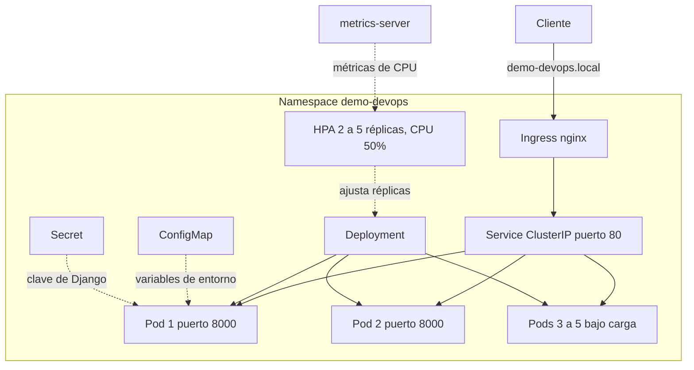
Todo vive en un namespace propio llamado `demo-devops`, para que no se mezcle con nada más del clúster.

El ConfigMap lleva lo que no es sensible, que son el nombre de la base de datos, `DJANGO_DEBUG` en `False` y la lista de hosts permitidos (`demo-devops.local`, `localhost` y `127.0.0.1`). El Secret lleva únicamente la clave de Django. En el repo solo hay un `secret.example.yaml` con un valor de relleno que dice `devsu-test`. La clave de verdad se genera aleatoria y se crea directo en el clúster con `kubectl`, así que nunca pasa por Git. Lo repito otra vez porque quiero que quede clarísimo, la clave real no está en ningún archivo del repositorio.

El Deployment tiene dos réplicas y usa la imagen con una etiqueta fija (`sha-...`) y no `latest`, para saber siempre qué versión corre. Las actualizaciones son progresivas, con `maxSurge: 1` y `maxUnavailable: 0`, lo que significa que durante un despliegue nunca hay menos pods disponibles de los que debería haber. Con `topologySpreadConstraints` pido que las réplicas se repartan entre los nodos, con una diferencia máxima de uno.

Las probes de salud, `readinessProbe` y `livenessProbe`, apuntan a `/health/`. Aquí hay un detalle que me costó pensarlo y vale la pena explicarlo. El kubelet consulta usando la IP del pod como host, y Django rechaza cualquier host que no esté en `ALLOWED_HOSTS`, así que las probes habrían fallado. La solución fue que las probes manden el encabezado `Host: localhost`, que sí está permitido.

Para los recursos puse requests de 100m de CPU y 192Mi de memoria, y límites de 500m y 384Mi. El request de CPU no es opcional en este caso, porque el HPA calcula el porcentaje de uso sobre ese valor y sin él no podría escalar.

En seguridad el pod corre como no root, con el mismo usuario y grupo (UID 100 y GID 101) que crea el Dockerfile. No permite escalada de privilegios, se quitan todas las capabilities de Linux, se usa el perfil seccomp por defecto y no se monta el token de la API de Kubernetes, porque la app no lo necesita para nada.

El Service es de tipo `ClusterIP`, escucha en el puerto 80 y manda el tráfico al 8000 de los pods. Quien da la cara hacia afuera es el Ingress, que usa la clase `nginx` y el host `demo-devops.local`. Por último, el HPA mantiene entre 2 y 5 réplicas y busca que el uso de CPU ronde el 50% de lo solicitado.

## Correrlo en local

Necesitamos Docker, minikube y kubectl. Yo lo probé con minikube con tres nodos y Kubernetes 1.35.

```bash
minikube start --driver=docker --nodes 3
minikube addons enable ingress
minikube addons enable metrics-server

kubectl apply -f k8s/namespace.yaml
kubectl apply -f k8s/configmap.yaml

kubectl create secret generic demo-devops-secret \
  --namespace demo-devops \
  --from-literal=DJANGO_SECRET_KEY="$(openssl rand -base64 48)"

kubectl apply -f k8s/deployment.yaml -f k8s/service.yaml \
              -f k8s/ingress.yaml -f k8s/hpa.yaml

kubectl rollout status deployment/demo-devops -n demo-devops
kubectl get pods -n demo-devops -o wide
```

Ojo con esto. No ejecutes `kubectl apply -f k8s/` sobre la carpeta completa. Incluiría el `secret.example.yaml` y pisaría el Secret real con el valor de relleno, y la app se quedaría con una clave que no es la que generaste.

Para entrar por el Ingress con el driver de Docker (en Windows y macOS la IP del Ingress no se alcanza directo) hace falta el túnel de minikube. Se abre en otra terminal y se queda corriendo. El encabezado `Host` evita tener que editar el archivo `hosts`.

```bash
minikube tunnel

curl -H "Host: demo-devops.local" http://127.0.0.1/health/
curl -H "Host: demo-devops.local" http://127.0.0.1/api/users/
```

Si solo quieres probar el Service sin pasar por el Ingress, un `port-forward` alcanza.

```bash
kubectl port-forward svc/demo-devops 18080:80 -n demo-devops
curl http://localhost:18080/health/
```

## La prueba de carga

El archivo `docs/load-generator.yaml` define un pod temporal que le lanza peticiones sin parar al Service. Lo dejé en `docs/` y no en `k8s/` a propósito, para que nunca se despliegue junto con la aplicación por accidente.

```bash
kubectl apply -f docs/load-generator.yaml
kubectl get hpa -n demo-devops -w
kubectl delete -f docs/load-generator.yaml
```

Con la carga encendida la CPU se fue hasta 295% del objetivo, y el HPA pasó de 2 a 4 réplicas y enseguida a 5, que es el máximo que configuré. Todo eso en menos de un minuto. Con las 5 réplicas la CPU bajó a un 128% aproximado, todavía por encima del 50%, pero ya no creció más porque el HPA respetó el tope de `maxReplicas`. Eso es justo lo que quería, un límite que proteja al clúster de un consumo descontrolado. Los 5 pods quedaron repartidos entre los tres nodos, dos en uno, dos en otro y uno en el tercero.

Cuando retiré la carga el HPA no bajó las réplicas de inmediato. Por defecto espera unos 5 minutos con la carga baja antes de reducir, para no estar subiendo y bajando pods sin necesidad. Pasado ese tiempo vuelve a 2.

## Evidencias

Las capturas están en `docs/evidencias/`.

Esta es la ejecución completa del pipeline con los tres jobs en verde.

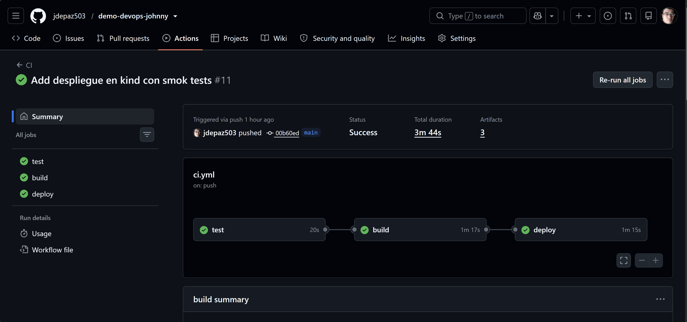

Esta es la tabla de cobertura del job `test`.

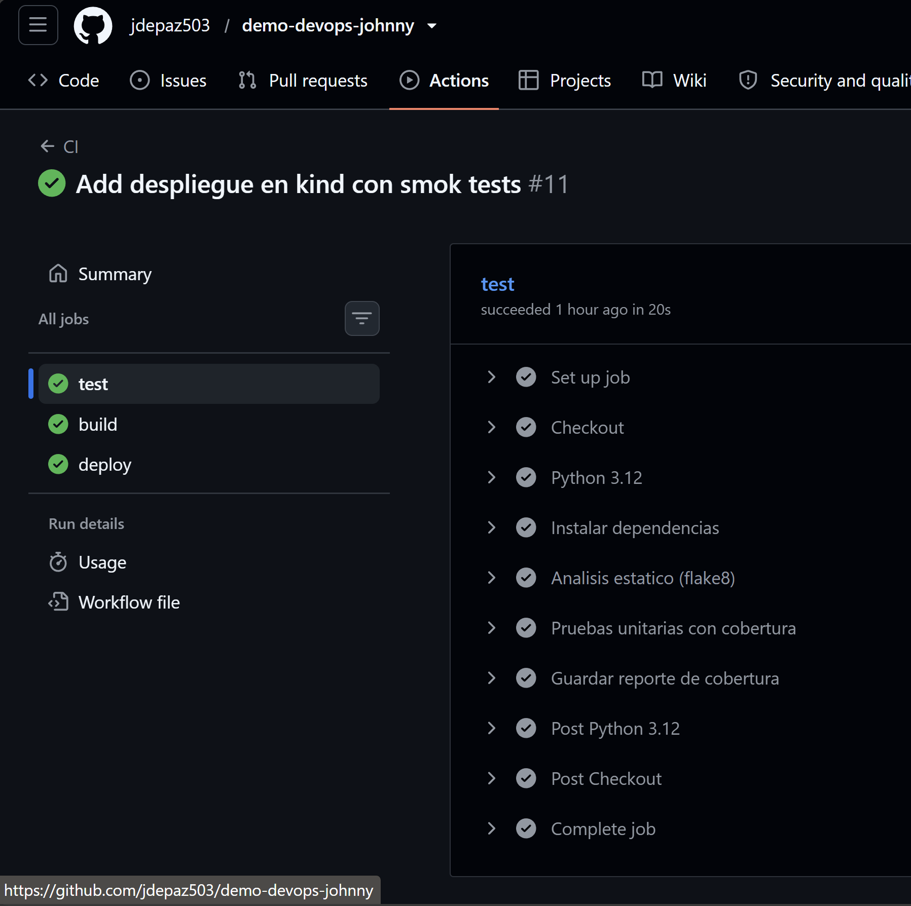

Aquí está el paso de Trivy, que pasa sin vulnerabilidades graves.

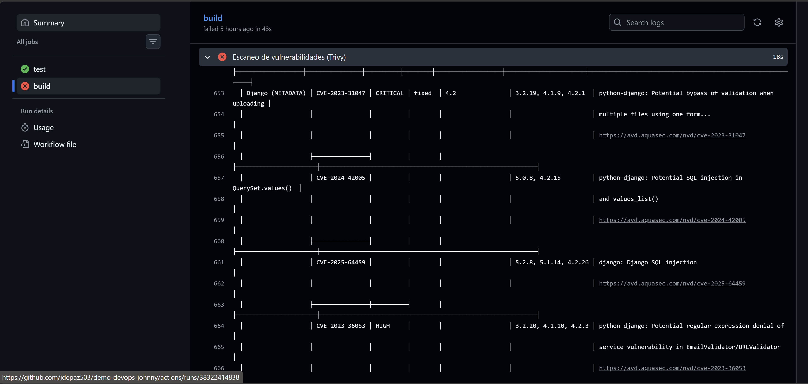
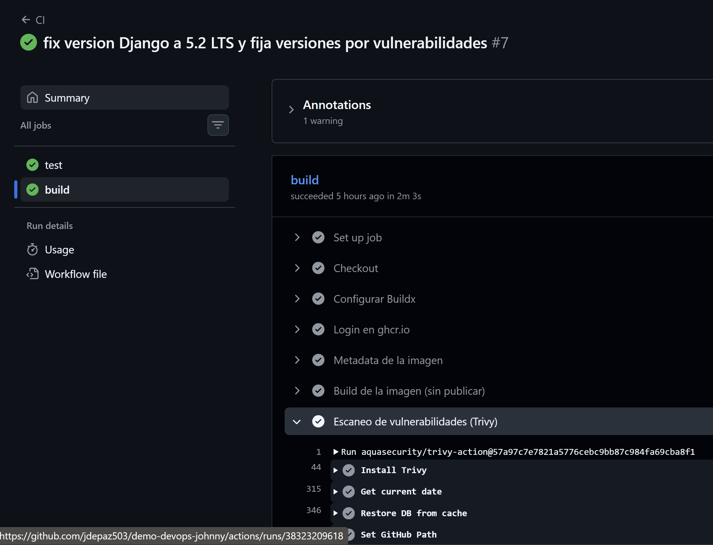

Este es el estado final del despliegue en kind dentro del pipeline.

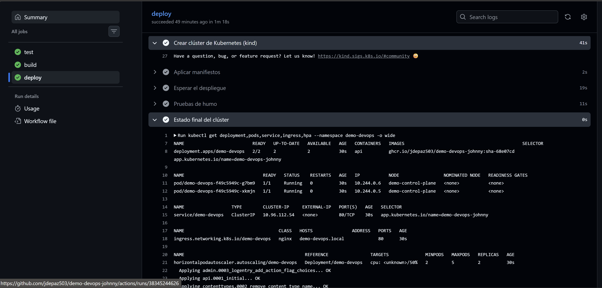

Los pods repartidos entre los tres nodos de minikube.

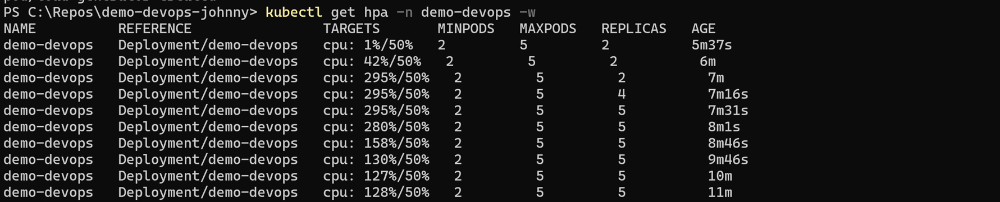

El HPA subiendo de 2 a 5 réplicas bajo carga.

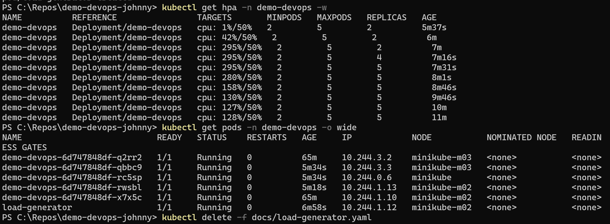

El HPA bajando de nuevo a 2 réplicas cuando se quitó la carga.

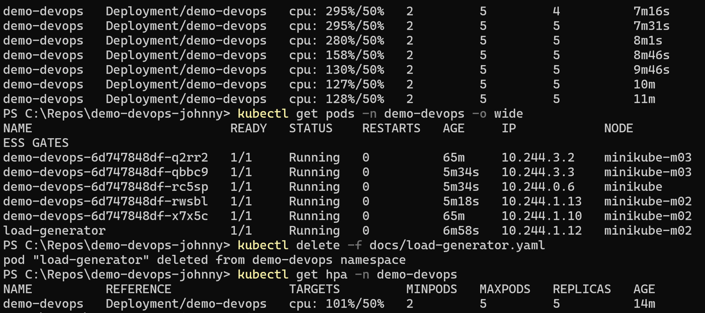

Y el acceso a la app por el Ingress con `curl`.
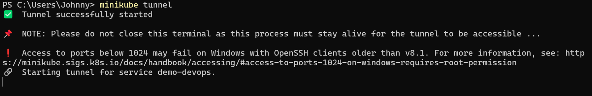
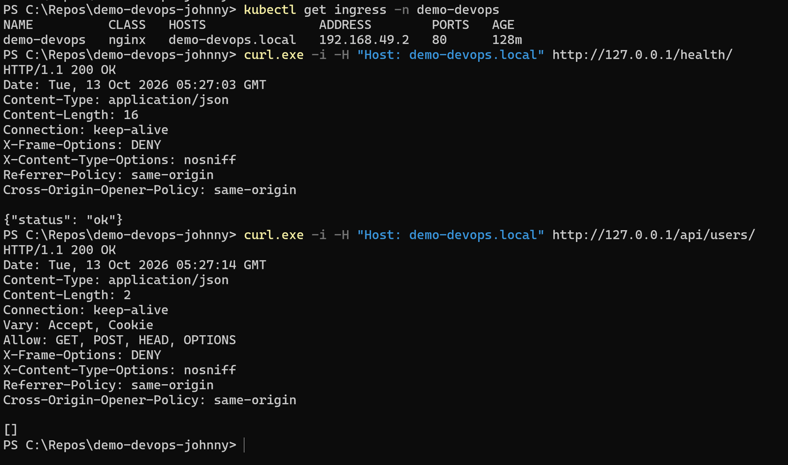

## Cosas que me pasaron en el camino

Dejo esto porque creo que ayuda a entender por qué algunas cosas están como están.

Lo primero fue casi un susto. El proyecto base trae un archivo `.env` con la clave de Django, y el `.gitignore` original no lo ignoraba. Lo vi justo a tiempo en el `git status`, antes de hacer el primer commit, porque si hubiera corrido `git add .` esa clave habría quedado en un repositorio público. Lo agregué al `.gitignore` y al `.dockerignore` y de ahí salió el `.env.example`.

Cuando armé la primera versión del pipeline, flake8 lo hizo fallar con una veintena de avisos. Pude haber aflojado las reglas del linter para que pasara, pero preferí arreglar el código, y eso me dejó el repo más limpio. Fue sobre todo formato, aunque también había imports que no se usaban.

Lo más interesante pasó con Trivy. La primera vez que lo puse en el pipeline detuvo la publicación de la imagen. Encontró 20 vulnerabilidades (3 críticas y 17 altas) y todas estaban en Django 4.2, ya que el sistema operativo de la imagen salió limpio. Resulta que Django 4.2 ya no recibe parches de seguridad, y una de esas vulnerabilidades (CVE-2026-15307, de GeoDjango) ni siquiera tiene corrección en esa serie. Mi app no usa GeoDjango, o sea que ese caso en concreto no se podía explotar, pero igual no me parecía bien dejar una versión sin soporte. Subí a Django 5.2 LTS y a Django REST Framework 3.16, y las pruebas unitarias confirmaron que no se rompió nada. Después fijé las versiones exactas en `requirements.txt` para que los builds se puedan repetir y los resultados de Trivy sean reproducibles.

También investigué la acción de Trivy antes de usarla y me encontré con que en marzo de 2026 sufrió un ataque a su cadena de suministro. Reescribieron etiquetas de versión de la acción para que apuntaran a código malicioso. Por eso en mi pipeline no uso una etiqueta como `@v0.35.0` a secas, sino el hash completo del commit (`57a97c7e...`) y el binario fijado en `v0.69.3`, versiones que las fuentes que consulté reportan como seguras. Cuando haya una versión más nueva verificada, la subo.

Una cosa más. Al probar con `port-forward` en el puerto 8080 me respondía un `401` en HTML antiguo que no venía de mi app, y resultó que otro programa de mi computadora ya tenía ese puerto ocupado. Cambié al 18080 y listo. Si les pasa algo parecido, es eso.

Y por último, el `kubectl` que trae Docker Desktop en mi máquina es la 1.25 y mi clúster es 1.35, bastante distancia. Para no andar instalando cosas usé el `kubectl` que trae el propio minikube con `minikube kubectl --`.

## Lo que no hice y por qué

**La URL pública del endpoint.** Mi despliegue de referencia corre local, en minikube. No abrí ningún puerto del router de mi casa a internet. No lo necesita el ejercicio, expondría mi red para algo que es una demostración y dependería de que mi computadora estuviera encendida justo cuando alguien revise. Como alternativa, el job `deploy` levanta un clúster en GitHub Actions y prueba la aplicación en cada ejecución, y las capturas de arriba documentan el despliegue local con Ingress y autoescalado.

**SonarCloud.** Para el análisis estático usé flake8 porque corre dentro del pipeline sin cuentas, sin tokens y sin servicios externos. SonarCloud sería la mejora natural si quisiera reportes históricos y reglas de seguridad más amplias.

**Infraestructura como código.** No la incluí en esta entrega. Era un punto extra y el ejercicio lo resolví completo sin gastar nada, con kind y minikube.

**El alcance del despliegue en el pipeline.** El clúster kind es de un solo nodo y no trae `metrics-server` ni controlador de Ingress. El HPA y el Ingress se aplican, lo cual valida que Kubernetes acepta los manifiestos, pero no se ejercitan en CI. Por eso el HPA muestra `unknown` ahí y el Ingress no tiene dirección. El reparto entre nodos, el escalado y el enrutamiento por host los demostré en minikube.

**Los estáticos del administrador.** Con `DEBUG` apagado, `/admin/` no sirve sus hojas de estilo, porque no configuré `STATIC_ROOT` ni un servidor de archivos estáticos. La API no se ve afectada. Se arregla con WhiteNoise o con un CDN.

## Si esto fuera a producción

Lo primero que cambiaría es la base de datos. SQLite es un archivo local, así que con varias réplicas cada pod tiene su propia base y los datos ni se comparten ni sobreviven a un reinicio. En producción usaría una base administrada, como PostgreSQL. Con eso resuelto, las migraciones dejarían de correr al arrancar cada contenedor y pasarían a un `Job` o un `initContainer` que las ejecute una sola vez antes de cada despliegue.

Pondría un DNS real para el host y certificados TLS con cert-manager y Let's Encrypt en el Ingress. Sobre el controlador de Ingress, el que usa el complemento de minikube (Ingress NGINX, el de la comunidad de Kubernetes) fue retirado en marzo de 2026 y ya no recibe parches de seguridad. Para un laboratorio local lo acepté, porque no está expuesto a internet y es lo que viene en minikube. En producción migraría a un controlador que se mantenga activo o a Gateway API.

Los secretos los manejaría con External Secrets, Sealed Secrets o un gestor como Vault, en vez de crearlos a mano con `kubectl`. Le sumaría `NetworkPolicy` para limitar el tráfico entre pods y un `PodDisruptionBudget` para sostener disponibilidad durante mantenimientos, y ajustaría los límites de recursos con mediciones reales y no con estimaciones. Agregaría observabilidad, con métricas en Prometheus, logs centralizados y alertas. A las imágenes les haría referencia por digest, las firmaría (por ejemplo con cosign) y publicaría un SBOM. Y si el registro fuera privado, haría falta `imagePullSecrets`. Por último, los archivos estáticos saldrían de WhiteNoise o de un CDN.

## Referencias

- Retiro de Ingress NGINX, anuncio oficial, https://kubernetes.io/blog/2025/11/11/ingress-Nginx-retirement/
- Retiro de Ingress NGINX, declaración de los comités de Kubernetes, https://www.kubernetes.io/blog/2026/01/29/ingress-nginx-statement/
- Incidente de seguridad de Trivy, aviso oficial, https://github.com/aquasecurity/trivy/security/advisories/GHSA-69fq-xp46-6x23
- Notas de la versión 5.2.17 de Django, https://docs.djangoproject.com/en/5.2/releases/5.2.17/
