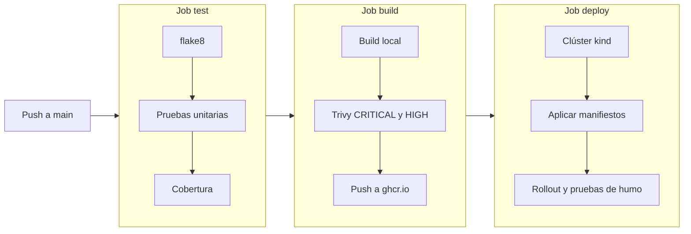
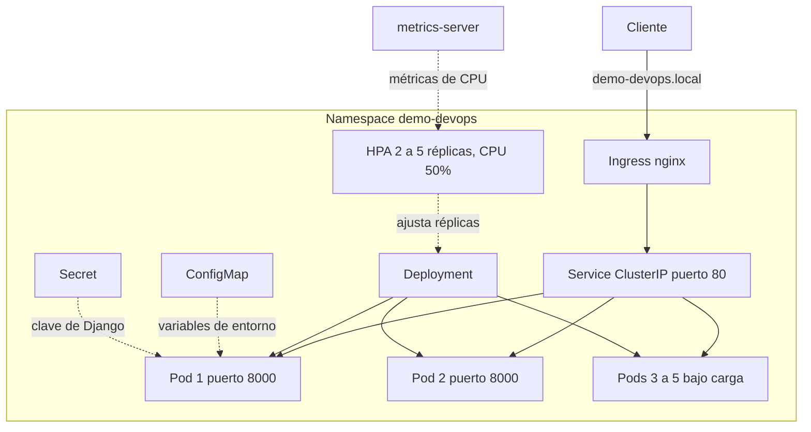

# demo-devops-johnny

Ejercicio práctico DevOps realizado por **Johnny De Paz**.

Es una API REST en Django que se empaqueta en Docker, se valida y publica con GitHub Actions y se despliega en Kubernetes con ConfigMap, Secret, Service, Ingress y autoescalado horizontal. Todo se puede reproducir con herramientas gratuitas y sin ninguna cuenta de pago.

- Repositorio público: https://github.com/jdepaz503/demo-devops-johnny
- Ejecuciones del pipeline: https://github.com/jdepaz503/demo-devops-johnny/actions
- Imagen publicada: `ghcr.io/jdepaz503/demo-devops-johnny` (paquete público)

## 1. Resumen de la entrega

| Requerimiento | Estado | Dónde verlo |
|---|---|---|
| Dockerizar la aplicación | Cumplido | `Dockerfile`, sección 4 |
| Pipeline como código | Cumplido | `.github/workflows/ci.yml`, sección 5 |
| Pruebas unitarias | Cumplido | job `test` |
| Análisis estático | Cumplido con flake8 | job `test`, ver sección 11 |
| Cobertura de código | Cumplido, 96% | job `test` |
| Construir y subir la imagen | Cumplido, ghcr.io | job `build` |
| Escaneo de vulnerabilidades (opcional) | Cumplido con Trivy | job `build` |
| Despliegue a Kubernetes dentro del pipeline | Cumplido sobre kind | job `deploy` |
| Mínimo dos réplicas y escalamiento horizontal | Cumplido | `k8s/deployment.yaml`, `k8s/hpa.yaml` |
| ConfigMap, Secret e Ingress | Cumplido | carpeta `k8s/` |
| Documentación y diagramas | Cumplido | este archivo |
| URL pública del endpoint | No incluida | sección 11 |
| Infraestructura como código (puntos extra) | No incluida | sección 11 |

## 2. La aplicación

Es el proyecto base de Python entregado con el ejercicio. Usa Django 5.2 LTS, Django REST Framework 3.16, django-environ y gunicorn como servidor de aplicación.

| Ruta | Descripción |
|---|---|
| `GET /health/` | Estado de la aplicación. Lo usan Docker y Kubernetes para saber si está viva. No consulta la base de datos. |
| `GET /api/users/` y `POST /api/users/` | Listar y crear usuarios. |
| `GET /api/users/{id}/`, `PUT`, `PATCH`, `DELETE` | Consultar, actualizar y borrar un usuario. |
| `/admin/` | Administrador de Django. |

### Cambios hechos sobre el proyecto original

- `DEBUG` y `ALLOWED_HOSTS` ahora se leen de variables de entorno. `DEBUG` queda apagado por defecto, de modo que la app arranca segura si nadie configura nada.
- Se agregó la ruta `/health/`.
- Se corrigieron los avisos de flake8 (imports sin usar, `import *`, saltos de línea y espacios).
- Se pasó de Django 4.2 a Django 5.2 LTS y de DRF 3.14 a 3.16 por vulnerabilidades. El detalle está en la sección 10.
- Se agregó gunicorn y se fijaron todas las dependencias a versiones exactas.

### Variables de entorno

| Variable | Obligatoria | Descripción |
|---|---|---|
| `DJANGO_SECRET_KEY` | Sí | Clave secreta de Django. Es sensible y nunca va en el repositorio. |
| `DATABASE_NAME` | Sí | Nombre del archivo SQLite, por ejemplo `db.sqlite3`. |
| `DJANGO_DEBUG` | No | Por defecto `False`. |
| `DJANGO_ALLOWED_HOSTS` | No | Hosts permitidos separados por coma. |

El archivo `.env.example` sirve de plantilla para correr la app en una máquina local. El `.env` real está en `.gitignore` y en `.dockerignore`.

## 3. Estructura del repositorio

```text
.
├── .github/workflows/ci.yml     Pipeline completo (test, build, deploy)
├── api/                         Aplicación Django (modelos, vistas, pruebas)
├── demo/                        Configuración del proyecto Django
├── k8s/                         Manifiestos de Kubernetes
│   ├── namespace.yaml
│   ├── configmap.yaml
│   ├── secret.example.yaml      Plantilla, sin la clave real
│   ├── deployment.yaml
│   ├── service.yaml
│   ├── ingress.yaml
│   └── hpa.yaml
├── docs/
│   ├── load-generator.yaml      Pod que genera carga para probar el HPA
│   └── evidencias/              Capturas de pantalla
├── Dockerfile
├── .dockerignore
├── .gitattributes               Saltos de línea LF para lo que corre en Linux
├── .env.example
├── manage.py
└── requirements.txt
```

## 4. Docker

### Decisiones

- **Imagen base `python:3.12-slim`.** Es liviana y compatible con Django 5.2.
- **Usuario sin privilegios.** La aplicación corre con el usuario `app` y no como root.
- **Capas ordenadas para aprovechar la caché.** Primero se copia `requirements.txt` y se instalan las dependencias, y después el código. Si solo cambia el código, Docker reutiliza la capa de dependencias.
- **`.dockerignore`.** Deja fuera `.env`, `.git`, la base de datos local y las carpetas de infraestructura, así que ningún secreto termina dentro de la imagen.
- **gunicorn en lugar de `runserver`.** El servidor de desarrollo de Django no es para producción.
- **`HEALTHCHECK`.** Consulta `/health/` cada 30 segundos.
- **Variables de entorno.** Toda la configuración entra por variables, sin valores fijos en la imagen.
- **Migraciones al arrancar.** El contenedor ejecuta `migrate` antes de iniciar gunicorn. Es válido para este ejercicio y se explica como limitación en la sección 12.

### Construir y probar

```bash
docker build -t demo-devops-johnny:local .

docker run -d --name demo-test -p 8000:8000 \
  -e DJANGO_SECRET_KEY=devsu-test \
  -e DATABASE_NAME=db.sqlite3 \
  -e DJANGO_ALLOWED_HOSTS=localhost,127.0.0.1 \
  demo-devops-johnny:local

curl http://localhost:8000/health/
curl http://localhost:8000/api/users/
docker exec demo-test whoami        # responde "app"
docker ps                           # el estado debe decir (healthy)
docker rm -f demo-test
```

También se puede usar la imagen ya publicada.

```bash
docker pull ghcr.io/jdepaz503/demo-devops-johnny:latest
```

## 5. Pipeline de CI/CD

El pipeline está en `.github/workflows/ci.yml` y corre en GitHub Actions, que es gratuito en repositorios públicos. Se ejecuta en cada `push` a `main`. En los pull requests corre solo el job `test`, y los jobs `build` y `deploy` se omiten para que un PR nunca publique imágenes.



### Qué hace cada job

| Job | Pasos | Si falla |
|---|---|---|
| `test` | Instala dependencias, corre flake8, ejecuta las pruebas con `coverage`, publica `coverage.xml` como artefacto | No se construye ni se publica nada |
| `build` | Construye la imagen en local, la escanea con Trivy y solo si pasa la publica en ghcr.io con las etiquetas `latest` y `sha-<commit>` | No se publica una imagen con vulnerabilidades graves |
| `deploy` | Crea un clúster kind, aplica los manifiestos con la imagen del commit, espera el despliegue y prueba `/health/` y `/api/users/` | El pipeline queda en rojo |

### Decisiones del pipeline

- **El escaneo ocurre antes de publicar.** La imagen se construye primero en el runner y se escanea. Solo se sube al registro si no hay vulnerabilidades CRITICAL ni HIGH con corrección disponible.
- **Se despliega exactamente lo que se acaba de construir.** El job `deploy` reemplaza la etiqueta de la imagen por `sha-<commit>`, así nunca se usa `latest` ni una versión vieja.
- **Runner fijo.** Se usa `ubuntu-24.04` y no `ubuntu-latest`, para que un cambio de imagen de GitHub no altere el comportamiento del pipeline.
- **Permisos mínimos por job.** `test` y `deploy` solo leen el repositorio. Únicamente `build` puede escribir paquetes.
- **El Secret se genera en cada ejecución.** El job crea una clave aleatoria dentro del clúster temporal y no pasa por el repositorio ni por los logs.
- **Caché de capas de Docker** con el caché de GitHub Actions para acelerar los builds.
- **Acciones actualizadas a versiones que corren en Node 24**, para evitar los avisos de deprecación de Node 20.

### Sobre el aviso de Node 20 que queda en el job `build`

La acción de Trivy usa internamente `actions/cache`, y GitHub avisa que esa dependencia apunta a Node 20, aunque la ejecuta con Node 24 sin problema. No se corrige porque exigiría subir la acción de Trivy a una versión que no se verificó como segura (ver sección 10). Se priorizó la seguridad de la cadena de suministro sobre eliminar un aviso cosmético.

## 6. Kubernetes



### Recursos y decisiones

| Recurso | Archivo | Decisión |
|---|---|---|
| Namespace `demo-devops` | `namespace.yaml` | Aísla la aplicación del resto del clúster. |
| ConfigMap | `configmap.yaml` | Configuración no sensible (`DATABASE_NAME`, `DJANGO_DEBUG=False`, `DJANGO_ALLOWED_HOSTS`). |
| Secret | `secret.example.yaml` | Solo se versiona una plantilla. El Secret real se crea con `kubectl create secret` y una clave aleatoria. |
| Deployment | `deployment.yaml` | 2 réplicas, actualización progresiva, reparto entre nodos, probes, recursos y seguridad. |
| Service | `service.yaml` | `ClusterIP` en el puerto 80 hacia el puerto 8000 de los pods. Quien expone hacia afuera es el Ingress. |
| Ingress | `ingress.yaml` | Clase `nginx`, host `demo-devops.local`. |
| HPA | `hpa.yaml` | Entre 2 y 5 réplicas, objetivo del 50% de CPU sobre el request. |

### Detalles del Deployment

- **Imagen con etiqueta fija** (`sha-...`) y no `latest`, para saber siempre qué versión corre.
- **Actualización progresiva** con `maxSurge: 1` y `maxUnavailable: 0`, así nunca hay una caída durante un despliegue.
- **Reparto entre nodos** con `topologySpreadConstraints` por `kubernetes.io/hostname` y `maxSkew: 1`.
- **Probes de salud.** `readinessProbe` y `livenessProbe` consultan `/health/`. El kubelet usa la IP del pod como host y Django la rechazaría por `ALLOWED_HOSTS`, por eso las probes envían el encabezado `Host: localhost`.
- **Recursos.** Requests de 100m de CPU y 192Mi de memoria, límites de 500m y 384Mi. El request de CPU es obligatorio, porque el HPA calcula el porcentaje sobre ese valor.
- **Seguridad.** El pod corre como no root (UID 100 y GID 101, los del usuario `app` de la imagen), con `allowPrivilegeEscalation: false`, todas las capabilities de Linux eliminadas, perfil seccomp `RuntimeDefault` y sin montar el token de la API de Kubernetes.
- **Configuración inyectada** completa con `envFrom` desde el ConfigMap y el Secret.

## 7. Cómo reproducir el despliegue local

Requisitos: Docker, minikube y kubectl. El procedimiento se probó en minikube con 3 nodos y Kubernetes 1.35.

```bash
minikube start --driver=docker --nodes 3
minikube addons enable ingress
minikube addons enable metrics-server

kubectl apply -f k8s/namespace.yaml
kubectl apply -f k8s/configmap.yaml

kubectl create secret generic demo-devops-secret \
  --namespace demo-devops \
  --from-literal=DJANGO_SECRET_KEY="$(openssl rand -base64 48)"

kubectl apply -f k8s/deployment.yaml -f k8s/service.yaml \
              -f k8s/ingress.yaml -f k8s/hpa.yaml

kubectl rollout status deployment/demo-devops -n demo-devops
kubectl get pods -n demo-devops -o wide
```

> **Importante.** No ejecutes `kubectl apply -f k8s/` sobre la carpeta completa. Incluiría `secret.example.yaml` y reemplazaría el Secret real por el valor de relleno de la plantilla.

### Acceder a la aplicación

Con el Ingress, usando el túnel de minikube (con el driver de Docker en Windows y macOS la IP del Ingress no es alcanzable directamente). El encabezado `Host` evita tener que editar el archivo `hosts`.

```bash
minikube tunnel        # en otra terminal, se queda abierta

curl -H "Host: demo-devops.local" http://127.0.0.1/health/
curl -H "Host: demo-devops.local" http://127.0.0.1/api/users/
```

O de forma directa al Service.

```bash
kubectl port-forward svc/demo-devops 18080:80 -n demo-devops
curl http://localhost:18080/health/
```

## 8. Prueba de autoescalado

El archivo `docs/load-generator.yaml` define un pod temporal que lanza peticiones continuas al Service. Está fuera de `k8s/` a propósito, para que nunca se despliegue junto con la aplicación.

```bash
kubectl apply -f docs/load-generator.yaml
kubectl get hpa -n demo-devops -w
# al terminar
kubectl delete -f docs/load-generator.yaml
```

### Resultado observado

| Momento | CPU frente al objetivo | Réplicas |
|---|---|---|
| Sin carga | 1% de 50% | 2 |
| Pocos segundos después de iniciar la carga | 295% de 50% | 2 |
| Unos 15 segundos más tarde | 295% de 50% | 4 |
| Unos 30 segundos después del pico | 295% de 50% | 5 |
| Con 5 réplicas y la carga todavía activa | alrededor de 128% de 50% | 5, el máximo configurado |

El HPA subió de 2 a 5 réplicas en menos de un minuto y se detuvo en el límite de `maxReplicas`, lo que protege al clúster de un consumo descontrolado. Con las 5 réplicas los pods quedaron repartidos entre los tres nodos (2, 2 y 1), como pide la regla de distribución.

Al retirar la carga, el HPA no reduce de inmediato. Espera una ventana de estabilización de unos 5 minutos para evitar subir y bajar réplicas sin necesidad, y después vuelve a 2.

## 9. Evidencias

Las capturas están en `docs/evidencias/`.

| Evidencia | Archivo |
|---|---|
| Pipeline completo en verde | `docs/evidencias/01-pipeline-verde.png` |
| Reporte de cobertura (96%) | `docs/evidencias/02-cobertura.png` |
| Escaneo de Trivy en verde | `docs/evidencias/03-trivy.png` |
| Despliegue en kind dentro del pipeline | `docs/evidencias/04-deploy-kind.png` |
| Pods repartidos entre los tres nodos | `docs/evidencias/05-pods-nodos.png` |
| HPA subiendo de 2 a 5 réplicas | `docs/evidencias/06-hpa-escalado.png` |
| HPA reduciendo de nuevo a 2 réplicas | `docs/evidencias/07-hpa-reduccion.png` |
| Acceso por el Ingress con `curl` | `docs/evidencias/08-ingress.png` |


## 10. Decisiones de seguridad y cadena de suministro

### Django 4.2 reemplazado por Django 5.2 LTS

La primera versión del pipeline con Trivy detuvo la publicación de la imagen. Encontró **20 vulnerabilidades** (3 críticas y 17 altas) y todas estaban en Django 4.2, ya que el sistema operativo de la imagen salió limpio. Esa versión ya no recibe parches de seguridad, y una de las vulnerabilidades (CVE-2026-15307, de GeoDjango) no tiene corrección en la serie 4.2.

La aplicación no usa GeoDjango, así que ese caso concreto no era explotable. Aun así, se migró a Django 5.2 LTS y a Django REST Framework 3.16, que corrigen el problema, y las pruebas unitarias confirmaron que nada se rompió. Las versiones exactas quedaron fijadas en `requirements.txt` para que los builds sean reproducibles y los resultados de Trivy se puedan repetir.

### Trivy fijado por hash de commit

En marzo de 2026 el ecosistema de Trivy sufrió un ataque a su cadena de suministro. Se reescribieron etiquetas de versión de la acción `trivy-action` para que apuntaran a código malicioso. Por eso en este pipeline la acción se fija por el hash completo del commit (`57a97c7e...`, correspondiente a la v0.35.0) y el binario a `v0.69.3`, versiones que las fuentes consultadas reportan como seguras. Más adelante se puede subir a una versión nueva una vez verificada.

### Otras medidas

- El Secret real no está en el repositorio, solo una plantilla con un valor de relleno.
- El contenedor corre sin root, sin escalada de privilegios y sin capabilities.
- La imagen no contiene el archivo `.env`.

## 11. Requerimientos no cumplidos o parciales, y por qué

**URL pública del endpoint.** El despliegue de referencia corre en un clúster local con minikube. No abrí puertos del router de mi casa a internet. Es innecesario para este ejercicio, expone mi red y dependería de que mi equipo esté encendido cuando se revise. Como alternativa, el job `deploy` levanta un clúster temporal en GitHub Actions y prueba la aplicación en cada ejecución, y las capturas de la sección 9 documentan el despliegue local con Ingress y HPA.

**Análisis estático con flake8 y no con SonarCloud.** Se eligió flake8 porque corre dentro del pipeline sin servicios externos, sin cuentas ni tokens. SonarCloud sería una mejora natural para tener reportes históricos y reglas de seguridad más amplias.

**Infraestructura como código en un proveedor público.** Esta entrega no la incluye. Era un punto extra y el ejercicio se resolvió completo sin costo, con kind y minikube.

**Alcance del despliegue dentro del pipeline.** El clúster kind es de un solo nodo y no tiene `metrics-server` ni controlador de Ingress. El HPA y el Ingress se aplican, lo que valida que Kubernetes acepta los manifiestos, pero no se ejercitan en CI. El reparto entre nodos, el escalado y el enrutamiento por host se demostraron en minikube.

**Archivos estáticos del administrador.** Con `DEBUG` apagado, `/admin/` no sirve sus hojas de estilo, porque no se configuró `STATIC_ROOT` ni un servidor de estáticos. La API no se ve afectada. Se resolvería con WhiteNoise o con un CDN.

## 12. Consideraciones para producción

- **Base de datos.** SQLite es un archivo local, así que cada réplica tendría su propia base y los datos no se compartirían ni sobrevivirían a un reinicio del pod. En producción se usaría una base administrada, como PostgreSQL.
- **Migraciones.** Hoy corren al arrancar cada contenedor. Con varias réplicas conviene un `Job` o un `initContainer` que las ejecute una sola vez antes del despliegue.
- **TLS y DNS.** Un registro DNS real para el host y certificados con cert-manager y Let's Encrypt en el Ingress.
- **Controlador de Ingress.** Ingress NGINX, el controlador de la comunidad que usa el complemento de minikube, fue retirado en marzo de 2026 y ya no recibe parches de seguridad. Para un laboratorio local es aceptable, pero en producción se migraría a un controlador mantenido o a Gateway API.
- **Gestión de secretos.** External Secrets, Sealed Secrets o un gestor como Vault, en lugar de crear el Secret a mano.
- **Endurecimiento del clúster.** `NetworkPolicy` para limitar el tráfico, `PodDisruptionBudget` para sostener disponibilidad en mantenimientos y límites de recursos ajustados con mediciones reales.
- **Observabilidad.** Métricas con Prometheus, logs centralizados y alertas.
- **Imágenes.** Referenciarlas por digest, firmarlas (por ejemplo con cosign) y publicar un SBOM. Con un registro privado se necesitaría `imagePullSecrets`.
- **Archivos estáticos** servidos con WhiteNoise o un CDN.

## 13. Referencias

- Retiro de Ingress NGINX, anuncio oficial: https://kubernetes.io/blog/2025/11/11/ingress-Nginx-retirement/
- Retiro de Ingress NGINX, declaración de los comités de Kubernetes: https://www.kubernetes.io/blog/2026/01/29/ingress-nginx-statement/
- Incidente de seguridad de Trivy, aviso oficial: https://github.com/aquasecurity/trivy/security/advisories/GHSA-69fq-xp46-6x23
- Notas de la versión 5.2.17 de Django: https://docs.djangoproject.com/en/5.2/releases/5.2.17/
