# demo-devops-johnny

Soy [Johnny De Paz](https://www.linkedin.com/in/jdepaz2012/) y este es mi ejercicio práctico de DevOps. Escogí la aplicación de Python (Django) que venía en el proyecto base y la llevé de punta a punta. La metí en Docker, armé un pipeline en GitHub Actions que la prueba, la revisa y la publica, y la desplegué en Kubernetes con sus dos réplicas, su ConfigMap, su Secret, su Ingress y autoescalado horizontal.

Esta es mi segunda entrega. Después de la revisión me marcaron cinco puntos para fortalecer la solución, y en este README cuento qué hice con cada uno y qué quedó pendiente.

Algo que quise desde el principio fue que todo se pudiera repetir sin pagar un solo centavo. No hay nube de pago ni tarjeta de por medio. Todo corre con GitHub Actions, el registro de imágenes de GitHub, SonarQube Cloud en su plan gratuito, kind dentro del pipeline y minikube en mi computadora.

Por si ayuda a la hora de revisar, lo principal está aquí.

- Repositorio público, https://github.com/jdepaz503/demo-devops-johnny
- Ejecuciones del pipeline, https://github.com/jdepaz503/demo-devops-johnny/actions
- API pública, https://demo-devops-johnny.onrender.com (plan gratuito, se duerme sin tráfico y el primer pedido puede tardar cerca de un minuto)
- Imagen publicada, `ghcr.io/jdepaz503/demo-devops-johnny` (el paquete es público, se puede bajar sin iniciar sesión)
- Análisis de calidad, https://sonarcloud.io/project/overview?id=jdepaz503_demo-devops-johnny

## Qué cambió desde la primera entrega

Estos eran los cinco puntos de la revisión y esto fue lo que pasó con cada uno.

- **SSL y DNS.** Hecho en el chart de Helm. El Ingress pide el certificado con cert-manager y se prueba con un nombre que resuelve solo (`demo.127.0.0.1.sslip.io`). Está en la sección "SSL y DNS".
- **Que la API esté disponible.** Hecho, con una advertencia. La API está publicada en https://demo-devops-johnny.onrender.com, en el plan gratuito de Render, y un flujo de GitHub Actions la consulta cada 10 minutos para mantenerla despierta y para dar la voz de alarma si deja de responder. Además el pipeline sigue desplegando y probando la aplicación en clústeres temporales en cada push. Está en la sección "La API en línea", con sus limitaciones.
- **Análisis estático con SonarQube.** Hecho. Corre dentro del job `test` y recibe el reporte de cobertura. Está en la sección "SonarQube Cloud".
- **Terraform con módulos parametrizados.** Hecho. Hay un módulo reutilizable y dos ambientes que lo usan con valores distintos, y el pipeline valida los dos y aplica uno. Está en la sección "Terraform".
- **Helm.** Hecho. Hay un chart con todo parametrizado y el pipeline despliega con él. Está en la sección "Helm".

## Qué cubre y qué no

Está hecho el Dockerfile, el pipeline completo (pruebas, análisis estático con flake8 y SonarQube, cobertura, escaneo de vulnerabilidades, construcción y publicación de la imagen, y despliegue a Kubernetes), los manifiestos planos de Kubernetes, el chart de Helm, el certificado TLS con cert-manager, el módulo de Terraform, la API publicada en Render y este README.

Hay limitaciones que explico con calma en la sección "Lo que no hice y por qué", porque el enunciado pide justificar lo que no se cumplió. La principal es que la API pública corre en un plan gratuito, con datos que no persisten y sin autenticación.

## La aplicación

Es una API REST con un solo recurso, los usuarios. Está hecha con Django 5.2 LTS, Django REST Framework 3.18, django-environ y gunicorn. Estas son las rutas.

- `GET /health/` devuelve `{"status": "ok"}`. La agregué yo, no hace consultas a la base de datos y la usan Docker y Kubernetes para saber si la app está viva.
- `GET /api/users/` y `POST /api/users/` para listar y crear usuarios.
- `GET`, `PUT`, `PATCH` y `DELETE` sobre `/api/users/{id}/` para el resto de las operaciones.
- `/admin/` es el administrador de Django.

Le cambié poco al código original, pero lo que cambié importa. `DEBUG` y `ALLOWED_HOSTS` estaban fijos en el código y ahora se leen de variables de entorno, con `DEBUG` apagado por defecto. Así, si alguien levanta la app sin configurar nada, arranca en modo seguro y no en modo desarrollo. También limpié los avisos de flake8 (imports que no se usaban, un `import *`, espacios y saltos de línea), subí Django de la 4.2 a la 5.2 y Django REST Framework de la 3.14 a la 3.18 por vulnerabilidades (la historia completa está más abajo) y fijé todas las dependencias a versiones exactas.

La app lee cuatro variables de entorno. `DJANGO_SECRET_KEY` y `DATABASE_NAME` son obligatorias. `DJANGO_DEBUG` y `DJANGO_ALLOWED_HOSTS` son opcionales. Para correrla en una máquina local dejé un `.env.example` con valores de mentira. El `.env` de verdad no se sube nunca, ni al repositorio ni a la imagen, y lo repito porque es de lo más importante de todo el proyecto.

## Cómo está armado el repositorio

```text
.
├── .github/workflows/
│   ├── ci.yml                   el pipeline completo
│   └── vigilancia.yml           consulta la API pública cada 10 minutos
├── api/                         la aplicación (modelos, vistas, pruebas)
├── demo/                        la configuración del proyecto Django
├── charts/demo-devops/          el chart de Helm
├── terraform/
│   ├── modules/demo-devops/     el módulo reutilizable
│   └── environments/            dev y prod, los dos usan el mismo módulo
├── k8s/                         los manifiestos planos de Kubernetes
│   ├── namespace.yaml
│   ├── configmap.yaml
│   ├── secret.example.yaml      solo una plantilla, sin la clave real
│   ├── deployment.yaml
│   ├── service.yaml
│   ├── ingress.yaml
│   └── hpa.yaml
├── docs/
│   ├── diagramas/               los diagramas de este README
│   ├── evidencias/              las capturas de pantalla
│   ├── letsencrypt-issuer.example.yaml
│   └── load-generator.yaml      pod para generar carga y probar el HPA
├── Dockerfile
├── .dockerignore
├── .gitattributes               fuerza saltos de línea LF en lo que corre en Linux
├── .env.example
├── sonar-project.properties     configuración del análisis de SonarQube
├── render.yaml                  el servicio gratuito de Render con la imagen publicada
├── manage.py
└── requirements.txt
```

## Docker

El Dockerfile parte de `python:3.12-slim`. La elegí porque es liviana y Django 5.2 la soporta sin problema. Mi Python local es la 3.14 y esa todavía no la soporta, así que en lugar de pelearme con eso todo lo probé dentro de la imagen, que de todas formas es donde tiene que funcionar.

La aplicación no corre como root. El Dockerfile crea un usuario llamado `app` y el contenedor arranca con ese usuario. Copio primero el `requirements.txt` e instalo las dependencias, y recién después copio el código. De esa forma, si solo cambio código, Docker reutiliza la capa de dependencias y el build sale mucho más rápido.

El `.dockerignore` deja afuera el `.env`, la carpeta `.git`, la base de datos local, las carpetas de infraestructura y la caché de los escáneres. O sea que ningún secreto puede terminar dentro de la imagen, aunque alguien se descuide. Esta lista creció durante el ejercicio por un hallazgo que cuento más abajo, y gracias a eso la imagen pasó de 1.8 GB a 155 MB.

En vez del servidor de desarrollo de Django usé gunicorn con dos workers, porque `runserver` no es para producción. La imagen trae un `HEALTHCHECK` que consulta `/health/` cada 30 segundos, y con eso `docker ps` te dice si el contenedor está sano.

Hay algo que sé que no es lo ideal. El contenedor corre las migraciones cada vez que arranca. Para este ejercicio funciona, pero con varias réplicas no es lo mejor, y lo comento en la parte de producción.

Para construirla y probarla.

```bash
docker build -t demo-devops-johnny:local .

docker run -d --name demo-test -p 8000:8000 \
  -e DJANGO_SECRET_KEY=devsu-test \
  -e DATABASE_NAME=db.sqlite3 \
  -e DJANGO_ALLOWED_HOSTS=localhost,127.0.0.1 \
  demo-devops-johnny:local

curl http://localhost:8000/health/
curl http://localhost:8000/api/users/
docker exec demo-test whoami
docker ps
docker rm -f demo-test
```

El `whoami` tiene que responder `app` y no `root`, y en `docker ps` el estado tiene que decir `healthy`. Si prefieres no construir nada, la imagen ya publicada se baja con `docker pull ghcr.io/jdepaz503/demo-devops-johnny:latest`.

## El pipeline

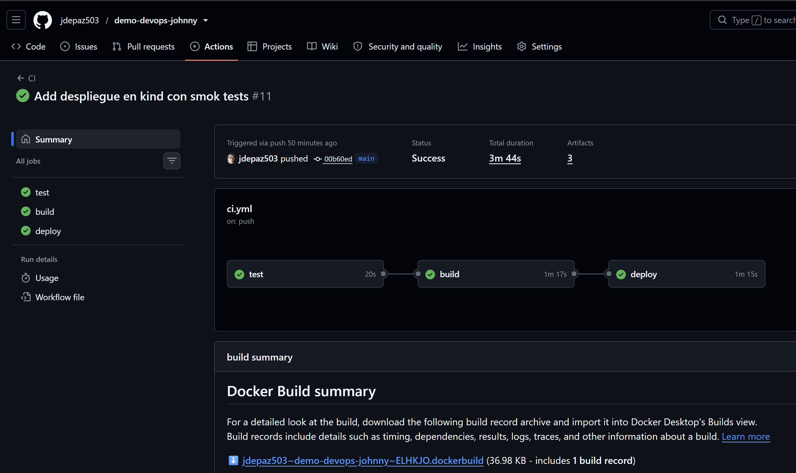

El pipeline vive en `.github/workflows/ci.yml` y corre en GitHub Actions, que es gratis en repositorios públicos. Se dispara con cada push a `main` y con los pull requests. En un pull request solo corre la parte de pruebas, porque no quiero que un PR publique imágenes ni despliegue nada.

Son cuatro jobs. Primero `test`, después `build`, y cuando `build` termina bien arrancan en paralelo `deploy` y `terraform`, cada uno con su propio clúster temporal.

El job `test` instala las dependencias, pasa flake8, corre las pruebas con coverage, valida el chart de Helm (`helm lint` en modo estricto y `helm template` con tres combinaciones de valores) y manda el análisis a SonarQube Cloud. Deja el `coverage.xml` como artefacto. La cobertura me dio 96% la última vez que la medí, y lo que queda sin cubrir son unas pocas líneas sueltas del modelo, de una vista, de `manage.py` y de la función `health`.

El job `build` construye la imagen una sola vez, con las etiquetas definitivas, la escanea con Trivy y solo si el escaneo pasa la sube a ghcr.io con dos etiquetas, `latest` y `sha-` seguido de los primeros siete caracteres del commit. Lo que se publica es exactamente lo que escaneó Trivy, y esto no siempre fue así (lo cuento más abajo). Escanear antes de publicar fue a propósito. Prefiero que una imagen con vulnerabilidades graves no llegue nunca al registro. El escaneo mira solo las vulnerabilidades CRITICAL y HIGH que ya tienen corrección disponible, y si encuentra alguna el pipeline se detiene.

El job `deploy` levanta un clúster temporal con kind y despliega con el chart de Helm, usando la etiqueta de la imagen del commit que se acaba de construir. Así lo que se despliega es siempre lo que se acaba de publicar, nunca `latest` ni una versión vieja. Después hace una actualización del release y comprueba que la clave del Secret no cambió, prueba `/health/` y `/api/users/`, y al final imprime el estado del clúster, aunque algo haya fallado, para poder ver qué pasó.

El job `terraform` valida el formato y la configuración de los dos ambientes, levanta su propio clúster kind, aplica el ambiente `dev` con la imagen del commit, prueba que la aplicación responda y deja a la vista las salidas de Terraform.

Hay unos detalles menores que me importaron. Fijé el runner en `ubuntu-24.04` y no en `ubuntu-latest`, porque GitHub avisó que `latest` iba a pasar a Ubuntu 26 a mitad de octubre y no quería que el pipeline cambiara de comportamiento justo cuando alguien lo estuviera revisando. Cada job tiene solo los permisos que necesita, y únicamente `build` puede escribir paquetes. Usé la caché de GitHub para las capas de Docker y subí las acciones a versiones que corren con Node 24. Y las acciones de terceros que tocan seguridad (Trivy, SonarQube y Terraform) están fijadas por el hash completo del commit y no por una etiqueta, por lo que cuento en "Cosas que me pasaron en el camino".

Queda un aviso de Node 20 en el job `build`. Viene de una dependencia interna de la acción de Trivy y no de mi archivo. Para quitarlo tendría que subir la acción de Trivy a una versión nueva que no verifiqué como segura, así que lo dejé como está. Prefiero un aviso que no molesta antes que arriesgar la cadena de suministro.

## Kubernetes

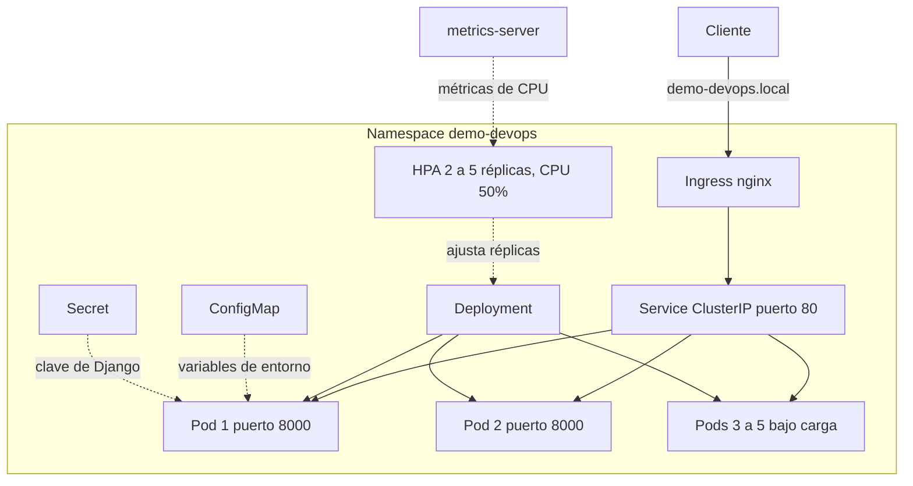

Todo vive en un namespace propio llamado `demo-devops`, para que no se mezcle con nada más del clúster.

El ConfigMap lleva lo que no es sensible, que son el nombre de la base de datos, `DJANGO_DEBUG` en `False` y la lista de hosts permitidos (`demo-devops.local`, `localhost` y `127.0.0.1`). El Secret lleva únicamente la clave de Django. En el repo solo hay un `secret.example.yaml` con un valor de relleno que dice `devsu-test`. La clave de verdad se genera aleatoria y se crea directo en el clúster, así que nunca pasa por Git. Lo repito otra vez porque quiero que quede clarísimo, la clave real no está en ningún archivo del repositorio.

El Deployment tiene dos réplicas y usa la imagen con una etiqueta fija (`sha-...`) y no `latest`, para saber siempre qué versión corre. Las actualizaciones son progresivas, con `maxSurge: 1` y `maxUnavailable: 0`, lo que significa que durante un despliegue nunca hay menos pods disponibles de los que debería haber. Con `topologySpreadConstraints` pido que las réplicas se repartan entre los nodos, con una diferencia máxima de uno.

Las probes de salud, `readinessProbe` y `livenessProbe`, apuntan a `/health/`. Aquí hay un detalle que me costó pensarlo y vale la pena explicarlo. El kubelet consulta usando la IP del pod como host, y Django rechaza cualquier host que no esté en `ALLOWED_HOSTS`, así que las probes habrían fallado. La solución fue que las probes manden el encabezado `Host: localhost`, que sí está permitido.

Para los recursos puse requests de 100m de CPU y 192Mi de memoria, y límites de 500m y 384Mi. El request de CPU no es opcional en este caso, porque el HPA calcula el porcentaje de uso sobre ese valor y sin él no podría escalar.

En seguridad el pod corre como no root, con el mismo usuario y grupo (UID 100 y GID 101) que crea el Dockerfile. No permite escalada de privilegios, se quitan todas las capabilities de Linux, se usa el perfil seccomp por defecto y no se monta el token de la API de Kubernetes, porque la app no lo necesita para nada.

El Service es de tipo `ClusterIP`, escucha en el puerto 80 y manda el tráfico al 8000 de los pods. Quien da la cara hacia afuera es el Ingress, que usa la clase `nginx` y el host `demo-devops.local`. Por último, el HPA mantiene entre 2 y 5 réplicas y busca que el uso de CPU ronde el 50% de lo solicitado.

Los archivos de `k8s/` son los manifiestos planos, que dejo como referencia de lo que Kubernetes recibe. La forma recomendada de desplegar es el chart de Helm, que genera estos mismos recursos pero parametrizados.

## Helm

El chart está en `charts/demo-devops/` y genera el ConfigMap, el Secret, el Deployment, el Service, el Ingress, el HPA y, si se pide, un emisor de certificados. Lo que antes estaba fijo en los manifiestos ahora se controla desde un solo `values.yaml`, que es la imagen, las réplicas, los recursos, el host del Ingress, el autoescalado, la seguridad del pod y el reparto entre nodos.

Hay cuatro decisiones que quiero dejar anotadas.

- Cuando el HPA está activo, el Deployment no fija el número de réplicas. Si lo fijara, cada `helm upgrade` le pelearía al autoescalado.
- El Secret se genera con una clave aleatoria y se conserva entre actualizaciones. El chart busca el Secret que ya existe y reutiliza su clave, así que un `helm upgrade` no la cambia y los pods no se reinician por eso. El pipeline lo comprueba en cada ejecución. También se puede apuntar a un Secret que ya exista con `secret.existingSecret`.
- El host del Ingress se agrega solo a los hosts permitidos de Django, para no tener que repetirlo en dos sitios.
- El Deployment lleva una anotación con el hash del ConfigMap, así que si cambia la configuración los pods se reinician solos.

Para instalarlo.

```bash
helm install demo-devops charts/demo-devops --namespace demo-devops --create-namespace
helm list -n demo-devops
```

Una cosa que aprendí por las malas y que conviene saber. Cuando haces `helm upgrade` sin pasar ningún valor, Helm reutiliza los de la revisión anterior, y si pasas alguno, parte de los valores por defecto del chart. Yo hice una actualización con `--set autoscaling.maxReplicas=6` y la siguiente, sin nada, se quedó con el 6 en lugar de volver al 5. No es un error del chart, es cómo funciona Helm. Por eso en el pipeline y en Terraform uso siempre `--reset-values`, que obliga a partir de lo que dice el chart más lo que se pasa explícitamente. Y por eso lo ideal es guardar los cambios de cada ambiente en un archivo de valores y no en `--set` sueltos.

El chart se instala desde la carpeta del repositorio y no está publicado en ningún registro de charts. Lo dejo anotado como pendiente.

## SSL y DNS

El Ingress puede pedir su certificado a cert-manager. En el chart hay un bloque `ingress.tls` con el interruptor del TLS y, dentro, uno de `certManager` con el tipo de emisor y su nombre. Todo viene apagado por defecto, así que el despliegue normal y el del pipeline no cambian.

Cuando se activa, el Ingress lleva la anotación `cert-manager.io/issuer` (o `cert-manager.io/cluster-issuer`, según el tipo) y cert-manager crea solo el certificado y el Secret `demo-devops-tls`, y lo renueva antes de que venza. Para el laboratorio el chart puede crear un emisor autofirmado. Para un servidor público se apunta a un `ClusterIssuer` de Let's Encrypt que ya exista, y en `docs/letsencrypt-issuer.example.yaml` dejé un ejemplo listo.

Para el DNS usé `sslip.io`, un servicio gratuito que resuelve nombres como `demo.127.0.0.1.sslip.io` a la dirección que lleva en el nombre (aquí `127.0.0.1`). Gracias a eso probé HTTPS con un nombre de dominio de verdad sin tocar el archivo `hosts`.

Primero se instala cert-manager y luego se despliega el chart con el TLS encendido.

```bash
helm repo add jetstack https://charts.jetstack.io --force-update
helm install cert-manager jetstack/cert-manager \
  --namespace cert-manager --create-namespace \
  --version v1.21.2 --set crds.enabled=true --wait

helm upgrade demo-devops charts/demo-devops --namespace demo-devops --reset-values \
  --set ingress.host=demo.127.0.0.1.sslip.io \
  --set ingress.tls.enabled=true \
  --set ingress.tls.certManager.enabled=true \
  --set ingress.tls.certManager.createSelfSignedIssuer=true \
  --wait

kubectl get issuer,certificate,secret -n demo-devops
minikube tunnel   # en otra terminal
curl -k -i https://demo.127.0.0.1.sslip.io/health/
```

Así queda el resultado. El certificado dura 90 días y cert-manager lo renueva el 30 de diciembre de 2026, antes de que venza el 29 de enero de 2027.

Hay una limitación que no quiero esconder. Como el emisor del laboratorio es autofirmado, ningún navegador ni `curl` lo reconoce, y por eso uso `-k`. Un certificado confiable de Let's Encrypt necesita un servidor con nombre público alcanzable desde internet, y mi minikube no lo es. La ruta para producción está lista (el ejemplo del emisor y el chart parametrizado), pero no la pude ejercitar de punta a punta.

## Terraform

La infraestructura como código está en `terraform/` y usa el proveedor de Helm. Es un módulo y dos ambientes.

El módulo, en `terraform/modules/demo-devops/`, instala el chart desde la ruta del repositorio. Sus variables son el nombre del release, el namespace, la etiqueta de imagen, las réplicas, los límites del autoescalado, el host, el TLS y el tiempo de espera. Sus salidas son el nombre del release, el namespace, el estado y la URL. Además trae una validación que impide que el máximo de réplicas sea menor que el mínimo.

Los ambientes, en `terraform/environments/dev` y `terraform/environments/prod`, llaman al mismo módulo con valores distintos. `dev` va sin TLS, con un máximo de 3 réplicas, y puede correr en cualquier clúster. `prod` tiene más margen de escalado (hasta 6 réplicas), un objetivo de CPU del 60% y TLS con cert-manager, que tiene que estar instalado. El proveedor se configura en cada ambiente y no dentro del módulo, para que el módulo se pueda reutilizar.

Dos detalles técnicos que me costaron un rato. El proveedor de Helm cambió de sintaxis en su versión 3 (los `set` pasaron de bloques repetidos a una lista y el bloque `kubernetes` a un atributo), así que el código está escrito con la sintaxis nueva y fijado a la serie 3. Y el archivo `.terraform.lock.hcl` lleva las huellas del proveedor para Windows, Linux y macOS, porque si solo trae las de la plataforma donde se generó, el pipeline (que corre en Linux) rechaza el proveedor.

```bash
cd terraform/environments/dev
terraform init
terraform plan -out=dev.tfplan
terraform apply dev.tfplan
terraform output
terraform destroy   # para limpiar
```

El plan crea un solo recurso, el `helm_release`, y las salidas muestran `status = "deployed"` y la URL. El estado de Terraform (`*.tfstate`), los planes (`*.tfplan`) y la carpeta `.terraform/` están en el `.gitignore` y no se suben.

En el pipeline, el job `terraform` valida el formato y la configuración de los dos ambientes y aplica `dev` sobre un clúster kind, y ese `apply` queda como evidencia reproducible sin que mi computadora participe. El ambiente `prod` solo se valida y nunca se aplica en CI, porque depende de cert-manager y el clúster del pipeline no lo tiene. Lo digo tal cual para que nadie piense que lo probé donde no lo probé.

## SonarQube Cloud

Para el análisis de calidad usé SonarQube Cloud (el nuevo nombre de SonarCloud), con su plan gratuito, que cubre repositorios públicos como este. El análisis corre en el job `test`, después de las pruebas, para poder usar el `coverage.xml` y mostrar la cobertura en su panel.

La configuración está en `sonar-project.properties` (la clave del proyecto, la organización, qué carpetas analizar y cuáles dejar fuera, como las migraciones y los manifiestos) y el token vive como un secreto del repositorio llamado `SONAR_TOKEN`, que nunca aparece en ningún archivo. El análisis corre solo en pushes, y el checkout del job trae el historial completo porque Sonar lo necesita para saber qué código es nuevo. La acción está fijada por el hash del commit de su versión 8.3.0.

Por ahora el pipeline sube el análisis pero no se detiene si el control de calidad (Quality Gate) sale en rojo. Lo hice así a propósito, para ver primero qué marcaba el panel y decidir con datos si convenía exigirlo. Exigirlo es el siguiente paso natural.

## La API en línea

La API pública está en https://demo-devops-johnny.onrender.com. La publiqué en Render, en su plan gratuito, porque no pide tarjeta y puede descargar directo la imagen que el pipeline publica en ghcr.io, así que no hay que construir nada de nuevo.

El servicio está descrito en el archivo `render.yaml` de la raíz del repositorio, que Render lee como un Blueprint. Ahí dice qué imagen usar, que el plan es el gratuito, la ruta de revisión de salud (`/health/`), el puerto (8000, con la variable `PORT`) y las variables de entorno. La clave de Django la genera Render al crear el servicio, así que no pasa por mí ni por el repositorio, y los hosts permitidos incluyen `.onrender.com`.

Para que la dirección raíz no se vea como un error, agregué una ruta `/` que responde con los enlaces útiles, y dos pruebas nuevas (la de `/health/` y la de `/`), con lo que la suite pasó de 3 a 5 pruebas.

```bash
curl https://demo-devops-johnny.onrender.com/
curl https://demo-devops-johnny.onrender.com/health/
curl https://demo-devops-johnny.onrender.com/api/users/
```

Hay cosas de esta publicación que conviene saber, porque es un plan gratuito y no quiero venderlo como lo que no es.

- **Se duerme.** Después de 15 minutos sin tráfico el servicio se apaga, y el primer pedido siguiente tarda cerca de un minuto en despertarlo. Para amortiguarlo, el flujo `.github/workflows/vigilancia.yml` consulta `/health/` cada 10 minutos, con reintentos largos para aguantar un despertar. Así la API casi siempre está despierta y, si deja de responder, la ejecución sale en rojo en la pestaña Actions. No lo garantiza al segundo, porque GitHub a veces retrasa los flujos programados y los pausa si el repositorio pasa 60 días sin actividad.
- **No guarda datos.** La base es SQLite dentro del contenedor y el plan gratuito no trae disco persistente, así que los usuarios que se creen se pierden cuando el servicio se reinicia o se duerme.
- **No tiene autenticación.** Cualquiera puede crear o borrar usuarios, y `/admin/` también está expuesto. Para un laboratorio lo acepté, pero no es algo que dejaría así en producción.
- **No se actualiza solo.** El servicio usa la etiqueta `latest` y Render no se entera cuando el pipeline publica una imagen nueva. Hoy lo actualizo a mano con **Manual Deploy**. El paso siguiente sería que el job `build` le avise a Render con un enlace de despliegue, y así el pipeline terminaría desplegando también en este entorno público.

## Correrlo en local

Necesitamos Docker, minikube y kubectl. Yo lo probé con minikube con tres nodos y Kubernetes 1.35.

```bash
minikube start --driver=docker --nodes 3
minikube addons enable ingress
minikube addons enable metrics-server
```

La forma recomendada es con el chart de Helm.

```bash
helm install demo-devops charts/demo-devops --namespace demo-devops --create-namespace
kubectl rollout status deployment/demo-devops -n demo-devops
kubectl get pods -n demo-devops -o wide
```

Si prefieres los manifiestos planos de `k8s/`, el Secret se crea aparte.

```bash
kubectl apply -f k8s/namespace.yaml
kubectl apply -f k8s/configmap.yaml

kubectl create secret generic demo-devops-secret \
  --namespace demo-devops \
  --from-literal=DJANGO_SECRET_KEY="$(openssl rand -base64 48)"

kubectl apply -f k8s/deployment.yaml -f k8s/service.yaml \
              -f k8s/ingress.yaml -f k8s/hpa.yaml
```

Ojo con esto. No ejecutes `kubectl apply -f k8s/` sobre la carpeta completa. Incluiría el `secret.example.yaml` y pisaría el Secret real con el valor de relleno, y la app se quedaría con una clave que no es la que generaste.

Para entrar por el Ingress con el driver de Docker (en Windows y macOS la IP del Ingress no se alcanza directo) hace falta el túnel de minikube. Se abre en otra terminal y se queda corriendo. El encabezado `Host` evita tener que editar el archivo `hosts`.

```bash
minikube tunnel

curl -H "Host: demo-devops.local" http://127.0.0.1/health/
curl -H "Host: demo-devops.local" http://127.0.0.1/api/users/
```

Si solo quieres probar el Service sin pasar por el Ingress, un `port-forward` alcanza.

```bash
kubectl port-forward svc/demo-devops 18080:80 -n demo-devops
curl http://localhost:18080/health/
```

## La prueba de carga

El archivo `docs/load-generator.yaml` define un pod temporal que le lanza peticiones sin parar al Service. Lo dejé en `docs/` y no en `k8s/` a propósito, para que nunca se despliegue junto con la aplicación por accidente.

```bash
kubectl apply -f docs/load-generator.yaml
kubectl get hpa -n demo-devops -w
kubectl delete -f docs/load-generator.yaml
```

Con la carga encendida la CPU se fue hasta 295% del objetivo, y el HPA pasó de 2 a 4 réplicas y enseguida a 5, que es el máximo que configuré. Todo eso en menos de un minuto. Con las 5 réplicas la CPU bajó a un 128% aproximado, todavía por encima del 50%, pero ya no creció más porque el HPA respetó el tope de `maxReplicas`. Eso es justo lo que quería, un límite que proteja al clúster de un consumo descontrolado. Los 5 pods quedaron repartidos entre los tres nodos, dos en uno, dos en otro y uno en el tercero.

Cuando retiré la carga el HPA no bajó las réplicas de inmediato. Por defecto espera unos 5 minutos con la carga baja antes de reducir, para no estar subiendo y bajando pods sin necesidad. Pasado ese tiempo vuelve a 2.

## Evidencias

Las capturas están en `docs/evidencias/`.

Esta es la ejecución completa del pipeline con todos sus jobs en verde.

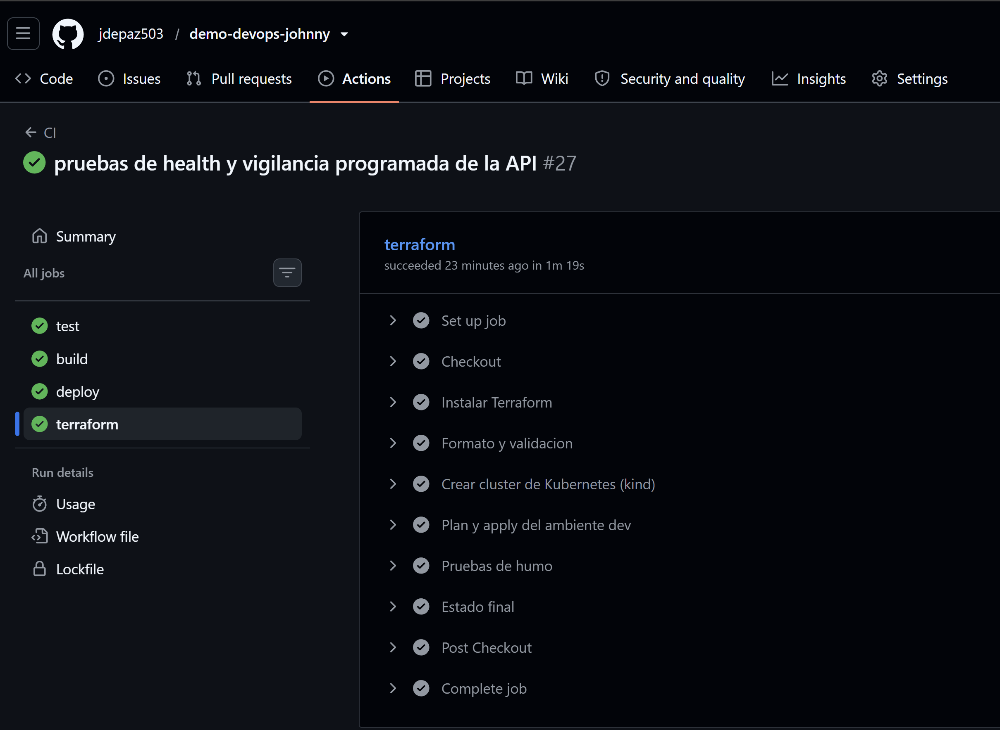

La primera ejecución completa, de la entrega anterior, con tres jobs.


Esta es la tabla de cobertura del job `test`.


Aquí están los dos resultados de Trivy. El primero es el que detuvo la publicación por las vulnerabilidades de Django 4.2, y el segundo es el escaneo limpio después de subir de versión.


Este es el estado final del despliegue en kind dentro del pipeline.


El paso de SonarQube Cloud dentro del job `test`.

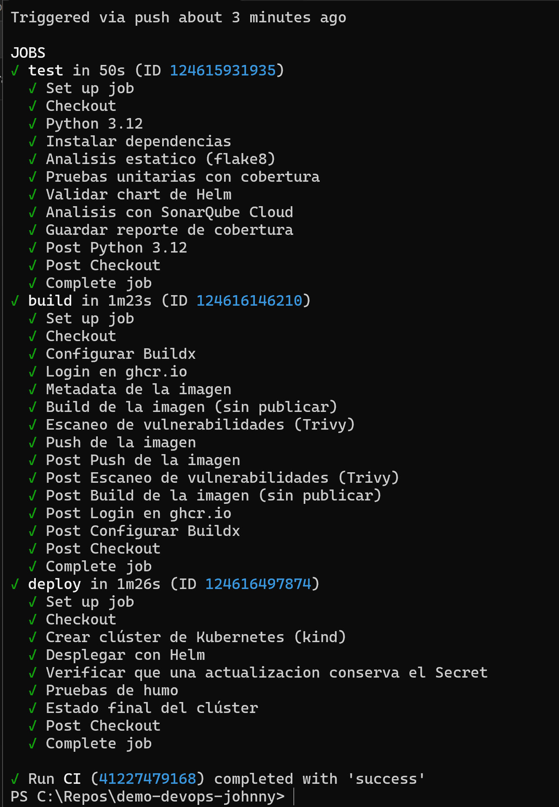

Los pods repartidos entre los tres nodos de minikube.


El HPA subiendo de 2 a 5 réplicas bajo carga.


El HPA bajando de nuevo a 2 réplicas cuando se quitó la carga.


El túnel de minikube y el acceso a la app por el Ingress con `curl`.


El certificado emitido por cert-manager, con el emisor y el Secret `demo-devops-tls` en estado listo.

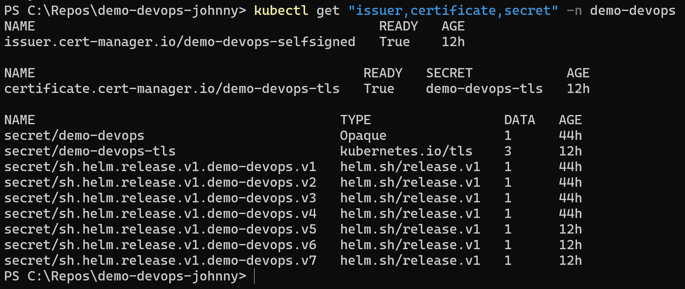

La app respondiendo por HTTPS a través del Ingress.

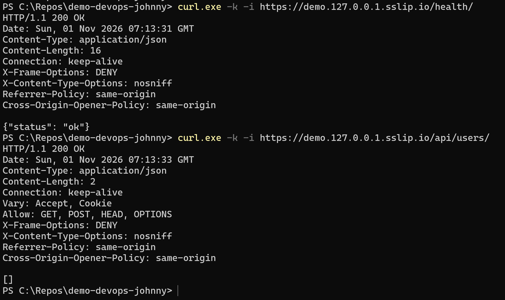

El detalle del certificado, con el dominio, el emisor y la fecha de renovación automática.

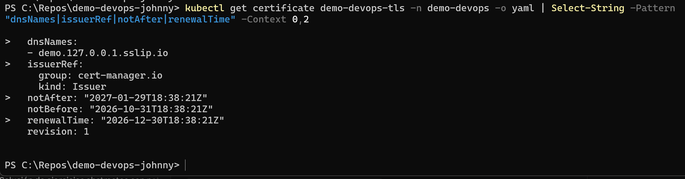

El historial de Helm, con la revisión fallida por la imagen pesada y la corrección posterior.

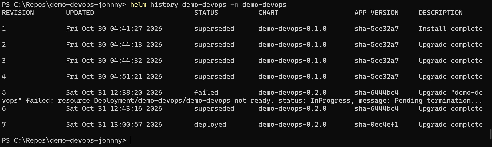

La imagen publicada por el pipeline, con sus 155 MB.

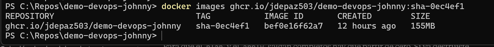

El `terraform plan` del ambiente `dev`.

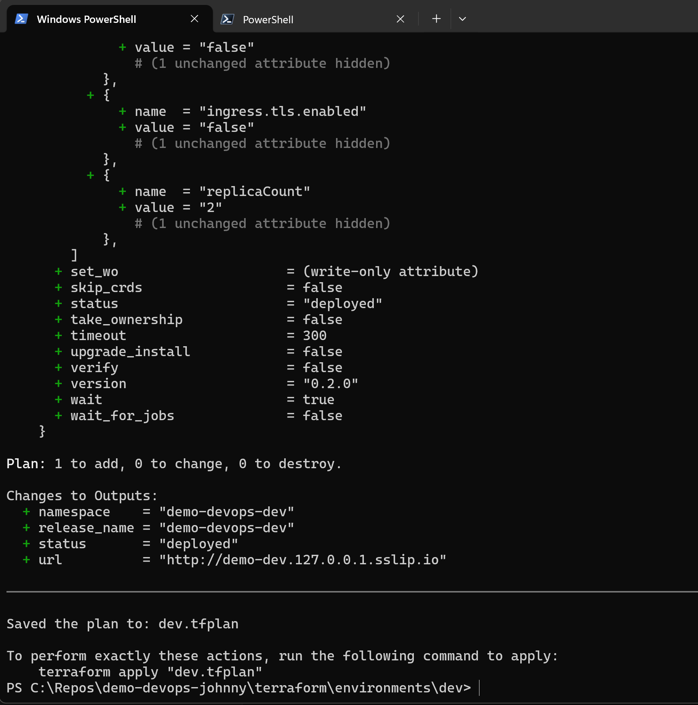

El `terraform apply` y las salidas.

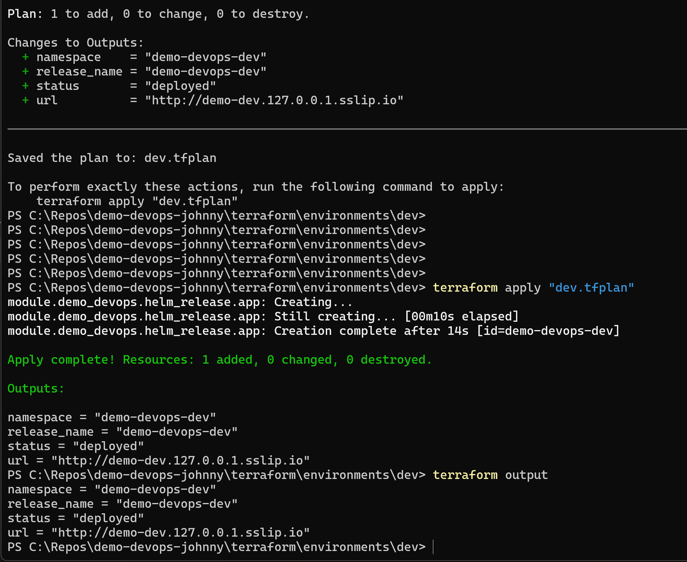

Y el mismo `apply` ejecutándose dentro del pipeline, sobre un clúster kind.

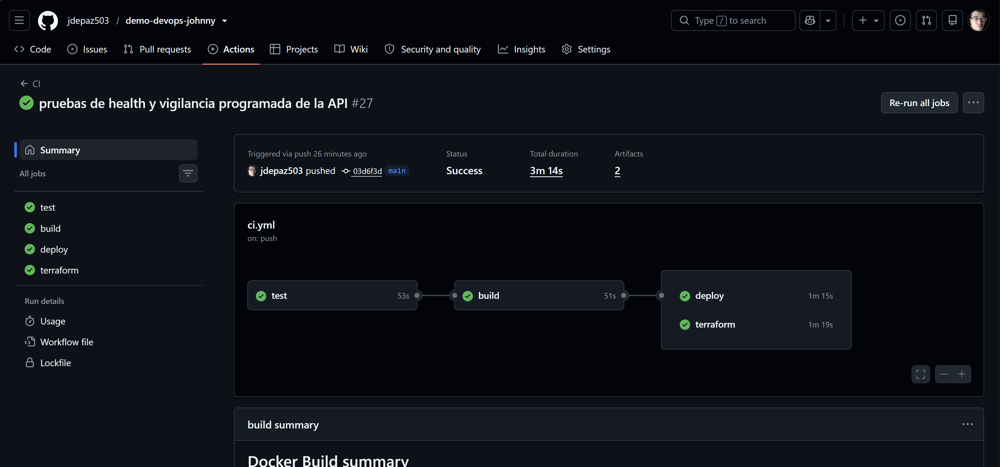

La API publicada en Render, con el estado Live y su dirección pública.

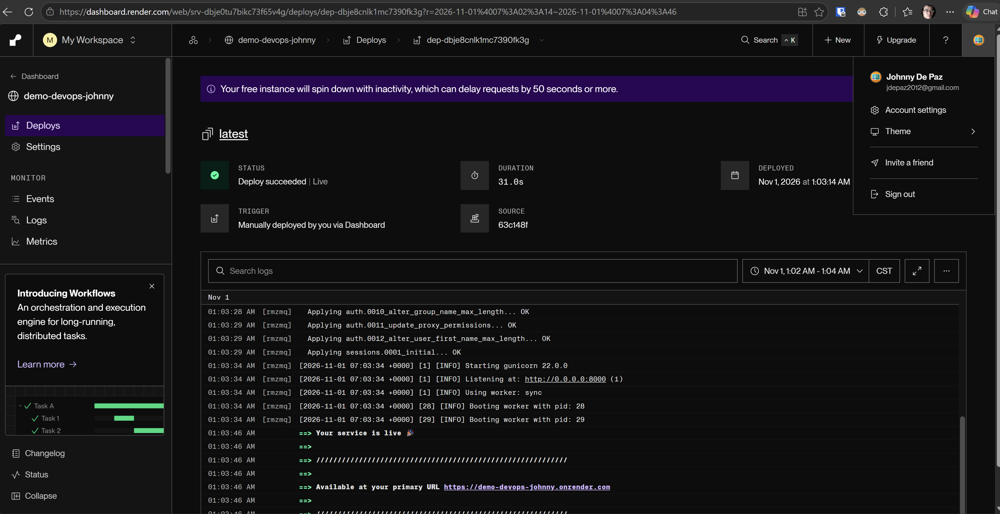

Y la API pública respondiendo por HTTPS desde el navegador.

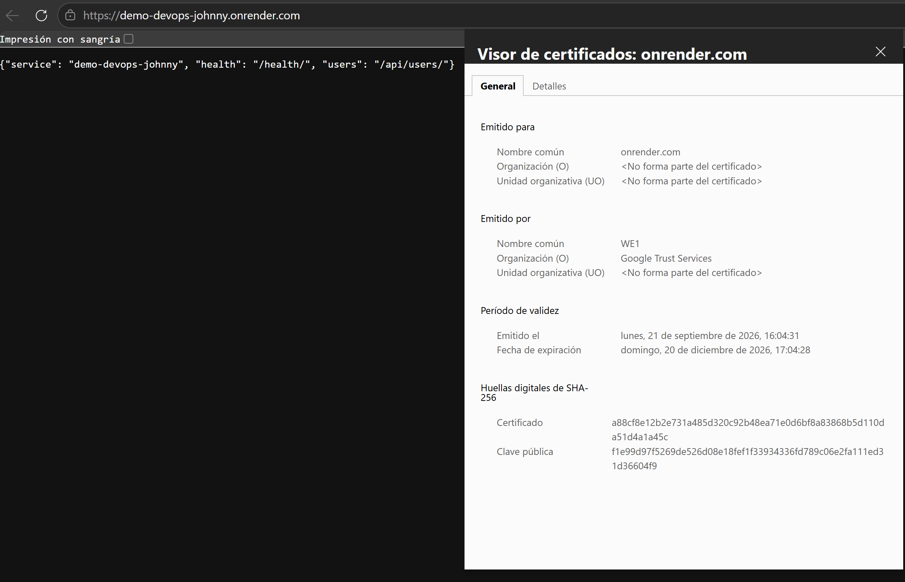

## Cosas que me pasaron en el camino

Dejo esto porque creo que ayuda a entender por qué algunas cosas están como están.

Lo primero fue casi un susto. El proyecto base trae un archivo `.env` con la clave de Django, y el `.gitignore` original no lo ignoraba. Lo vi justo a tiempo en el `git status`, antes de hacer el primer commit, porque si hubiera corrido `git add .` esa clave habría quedado en un repositorio público. Lo agregué al `.gitignore` y al `.dockerignore` y de ahí salió el `.env.example`.

Cuando armé la primera versión del pipeline, flake8 lo hizo fallar con una veintena de avisos. Pude haber aflojado las reglas del linter para que pasara, pero preferí arreglar el código, y eso me dejó el repo más limpio. Fue sobre todo formato, aunque también había imports que no se usaban.

Lo más interesante pasó con Trivy, y me pasó dos veces. La primera vez que lo puse en el pipeline detuvo la publicación de la imagen. Encontró 20 vulnerabilidades (3 críticas y 17 altas) y todas estaban en Django 4.2, ya que el sistema operativo de la imagen salió limpio. Resulta que Django 4.2 ya no recibe parches de seguridad, y una de esas vulnerabilidades (CVE-2026-15307, de GeoDjango) ni siquiera tiene corrección en esa serie. Mi app no usa GeoDjango, o sea que ese caso en concreto no se podía explotar, pero igual no me parecía bien dejar una versión sin soporte. Subí a Django 5.2 LTS y las pruebas unitarias confirmaron que no se rompió nada. Días después, sin que yo tocara el código, el escaneo volvió a fallar. Esta vez eran 3 vulnerabilidades altas en Django REST Framework 3.16.1, publicadas recientemente y corregidas en la 3.18.2 (dos de denegación de servicio y una de revocación de tokens que mi app no usa). Subí a la 3.18.3 y volvió a pasar. Esto me recordó por qué fijo las versiones exactas y por qué el escaneo vive en el pipeline y no se hace una sola vez, porque el mismo código puede escanear distinto otro día.

También investigué la acción de Trivy antes de usarla y me encontré con que en marzo de 2026 sufrió un ataque a su cadena de suministro. Reescribieron etiquetas de versión de la acción para que apuntaran a código malicioso. Por eso no uso una etiqueta como `@v0.35.0` a secas, sino el hash completo del commit (`57a97c7e...`) y el binario fijado en `v0.69.3`, versiones que las fuentes que consulté reportan como seguras. Apliqué la misma regla con las acciones de SonarQube y de Terraform (fijadas por hash) y elijo versiones que lleven al menos un par de semanas publicadas, porque un lanzamiento recién salido puede traer código que nadie ha revisado.

Otra cosa que me sorprendió fue el peso de la imagen. Un despliegue en mi minikube tardó tanto que Helm lo marcó como fallido (la revisión 5 de su historial), y al revisar los eventos vi que la imagen pesaba 1.8 GB cuando debería rondar los 250 MB. Entré a un pod y encontré una carpeta `.cache` de 1.6 GB, la base de datos de vulnerabilidades de Trivy. Pasaba que el pipeline construía la imagen para escanearla y luego la volvía a construir para publicarla, y en esa segunda vez la caché del escáner ya estaba en la carpeta del proyecto y `COPY . .` se la llevaba. O sea que se publicaba una imagen distinta de la que se había escaneado, y encima enorme. Lo arreglé de dos maneras, ampliando el `.dockerignore` y construyendo la imagen una sola vez, de modo que Trivy escanea y el pipeline publica exactamente esa misma. La imagen pasó a 155 MB.

Con SonarQube tuve un tropiezo simple. El primer análisis falló diciendo que había un análisis automático activo al mismo tiempo que el del pipeline, y bastó apagar el automático en la configuración del proyecto. Con Terraform me pasó algo parecido, el archivo de bloqueo del proveedor se había generado en Windows y habría fallado en el pipeline, que corre en Linux, hasta que le agregué las huellas de las otras plataformas. Y hubo un detalle que me dio risa, unos acentos en los nombres de los pasos del pipeline se convirtieron en símbolos raros por un problema de codificación de caracteres, y terminé quitándolos de los nombres para no depender de eso.

Con Render me pasaron dos cosas que me hicieron entender mejor cómo funciona. Al abrir la dirección en el navegador vi un `Not Found` y por un momento pensé que algo estaba roto, hasta que me di cuenta de que era la página de error de mi propia aplicación, que no tenía ninguna ruta en la raíz. Por eso agregué la ruta `/`. Y después de publicar el cambio la dirección siguió dando el error viejo, porque Render sigue usando la imagen que ya tenía hasta que se le pide un despliegue nuevo. Ahí entendí lo que pasa con una etiqueta como `latest`.

Una cosa más. Al probar con `port-forward` en el puerto 8080 me respondía un `401` en HTML antiguo que no venía de mi app, y resultó que otro programa de mi computadora ya tenía ese puerto ocupado. Cambié al 18080 y listo. Si les pasa algo parecido, es eso.

Y por último, el `kubectl` que trae Docker Desktop en mi máquina es la 1.25 y mi clúster es 1.35, bastante distancia. Para no andar instalando cosas usé el `kubectl` que trae el propio minikube con `minikube kubectl --`.

## Lo que no hice y por qué

**Una API pública siempre despierta, con datos y con autenticación.** La API pública existe, pero en un plan gratuito, con las limitaciones que conté en su sección. Se duerme sin tráfico (la vigilancia lo amortigua, no lo elimina), no guarda datos y no pide autenticación. Mi clúster de Kubernetes con Ingress, HTTPS y autoescalado sigue corriendo solo en mi computadora, porque no abrí ningún puerto del router de mi casa a internet. Expondría mi red para algo que es una demostración y dependería de que mi computadora estuviera encendida justo cuando alguien revise. En la primera revisión eso significó que la API no estaba activa, y por eso la publiqué en Render.

**El certificado de una CA real.** El TLS funciona con cert-manager, pero con un emisor autofirmado, porque para Let's Encrypt hace falta un servidor con nombre público. Dejé el emisor de ejemplo listo en `docs/`.

**Avisarle a Render cuando hay una imagen nueva.** Hoy actualizo el servicio a mano. Se puede automatizar con un enlace de despliegue que el pipeline llame al terminar el job `build`, y lo dejo como siguiente paso.

**El ambiente `prod` de Terraform aplicado.** Solo se valida. Depende de cert-manager y el clúster del pipeline no lo tiene.

**Exigir el Quality Gate de SonarQube.** El análisis se sube en cada push, pero el pipeline todavía no se detiene si el control de calidad sale en rojo.

**Publicar el chart en un registro.** El chart se instala desde la carpeta del repositorio y no está publicado en ningún registro de charts.

**El alcance del despliegue en el pipeline.** Los clústeres kind del pipeline son de un solo nodo y no traen `metrics-server` ni controlador de Ingress. El HPA y el Ingress se aplican, lo cual valida que Kubernetes acepta los manifiestos, pero no se ejercitan en CI. Por eso el HPA muestra `unknown` ahí y el Ingress no tiene dirección. El reparto entre nodos, el escalado y el enrutamiento por host los demostré en minikube.

**Los estáticos del administrador.** Con `DEBUG` apagado, `/admin/` no sirve sus hojas de estilo, porque no configuré `STATIC_ROOT` ni un servidor de archivos estáticos. La API no se ve afectada. Se arregla con WhiteNoise o con un CDN.

## Si esto fuera a producción

Lo primero que cambiaría es la base de datos. SQLite es un archivo local, así que con varias réplicas cada pod tiene su propia base y los datos ni se comparten ni sobreviven a un reinicio. En producción usaría una base administrada, como PostgreSQL. Con eso resuelto, las migraciones dejarían de correr al arrancar cada contenedor y pasarían a un `Job` o un `initContainer` que las ejecute una sola vez antes de cada despliegue.

Pondría un DNS real para el host y un certificado de Let's Encrypt con el emisor que dejé de ejemplo. Sobre el controlador de Ingress, el que usa el complemento de minikube (Ingress NGINX, el de la comunidad de Kubernetes) fue retirado en marzo de 2026 y ya no recibe parches de seguridad. Para un laboratorio local lo acepté, porque no está expuesto a internet y es lo que viene en minikube. En producción migraría a un controlador que se mantenga activo o a Gateway API.

Los secretos los manejaría con External Secrets, Sealed Secrets o un gestor como Vault, en vez de generarlos dentro del chart. Le sumaría `NetworkPolicy` para limitar el tráfico entre pods y un `PodDisruptionBudget` para sostener disponibilidad durante mantenimientos, y ajustaría los límites de recursos con mediciones reales y no con estimaciones. Guardaría el estado de Terraform en un almacenamiento remoto y cifrado, en lugar de en un archivo local. Agregaría observabilidad, con métricas en Prometheus, logs centralizados y alertas. A las imágenes les haría referencia por digest, las firmaría (por ejemplo con cosign) y publicaría un SBOM. Y si el registro fuera privado, haría falta `imagePullSecrets`. Por último, los archivos estáticos saldrían de WhiteNoise o de un CDN. Y le pondría autenticación a la API, porque la que está publicada en Render acepta peticiones de cualquiera.

## Referencias

- Retiro de Ingress NGINX, anuncio oficial, https://kubernetes.io/blog/2025/11/11/ingress-Nginx-retirement/
- Retiro de Ingress NGINX, declaración de los comités de Kubernetes, https://www.kubernetes.io/blog/2026/01/29/ingress-nginx-statement/
- Incidente de seguridad de Trivy, aviso oficial, https://github.com/aquasecurity/trivy/security/advisories/GHSA-69fq-xp46-6x23
- Notas de la versión 5.2.17 de Django, https://docs.djangoproject.com/en/5.2/releases/5.2.17/
- Certificados para Ingress con cert-manager, https://cert-manager.io/docs/usage/ingress/
- Versiones del proveedor de Helm para Terraform, https://github.com/hashicorp/terraform-provider-helm/releases
- sslip.io, https://sslip.io
